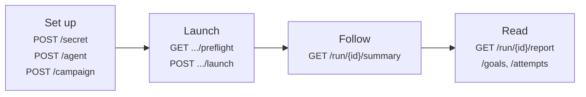

# Campaign lifecycle

This page runs a campaign from start to finish with the API: register the agent, save a campaign, check it, launch it, follow the run, then read the report. It is what the dashboard does when you launch a campaign.



The examples use `curl` and the Python `client` from [First request](./first-request.mdx#list-your-agents). Replace the ids with the ones your responses return.

## 1. Store the agent's key as a secret

If the agent you test needs an API key, store it as an organization secret first. Agents and campaigns never hold a credential, only a `${NAME}` reference to a secret, and nothing can read a secret's value back ([`POST /secret`](./reference/secret-create.api.mdx)):

<Tabs groupId="http-client">
<TabItem value="curl" label="curl" default>

```bash
curl -sS https://api.hackagent.dev/secret \
  -H "Authorization: Bearer $HACKAGENT_API_KEY" \
  -H "Content-Type: application/json" \
  -d '{"name": "SUPPORT_BOT_API_KEY", "value": "<the agent provider key>"}'
```

</TabItem>
<TabItem value="python" label="Python">

```python
client.post(
    "/secret",
    json={"name": "SUPPORT_BOT_API_KEY", "value": os.environ["SUPPORT_BOT_API_KEY"]},
).raise_for_status()
```

</TabItem>
</Tabs>

A name is 2 to 64 uppercase letters, digits and underscores, starting with a letter. To change the value later, use [`PUT /secret/{name}`](./reference/secret-update.api.mdx).

## 2. Register the agent

An agent is the target: a name and the model configuration HackAgent uses to reach it, in the same format as a campaign file's [`target`](../cli/campaign-files/target.md#modelconfig) ([`POST /agent`](./reference/agent-create.api.mdx)):

<Tabs groupId="http-client">
<TabItem value="curl" label="curl" default>

```bash
curl -sS https://api.hackagent.dev/agent \
  -H "Authorization: Bearer $HACKAGENT_API_KEY" \
  -H "Content-Type: application/json" \
  -d '{
    "name": "Support bot",
    "description": "Customer support assistant, staging deployment.",
    "config": {
      "name": "gpt-4o-mini",
      "connection": {
        "provider": "openai",
        "type": "OPENAI",
        "endpoint": "https://agent.example.com/v1",
        "api_key": "${SUPPORT_BOT_API_KEY}"
      }
    }
  }'
```

</TabItem>
<TabItem value="python" label="Python">

```python
agent = client.post(
    "/agent",
    json={
        "name": "Support bot",
        "description": "Customer support assistant, staging deployment.",
        "config": {
            "name": "gpt-4o-mini",
            "connection": {
                "provider": "openai",
                "type": "OPENAI",
                "endpoint": "https://agent.example.com/v1",
                "api_key": "${SUPPORT_BOT_API_KEY}",
            },
        },
    },
)
agent.raise_for_status()
agent_id = agent.json()["id"]
```

</TabItem>
</Tabs>

The response (`201`) carries the agent's `id`. Names are unique within your organization. A literal key in `api_key` gets `400`: only `${NAME}` references are accepted.

## 3. Save a campaign

A campaign names the agent and a **spec**: the attacks, the goals and the judges. The spec is a [campaign file](../cli/campaign-files/index.md) without `target` and `execution`, which come from the agent and the server. Two endpoints help you write one:

- [`GET /campaign/techniques`](./reference/campaign-techniques-list.api.mdx) lists the attack techniques, with their parameters and the model roles they need.
- [`GET /campaign/schema`](./reference/campaign-schema-retrieve.api.mdx) returns the JSON Schema specs are validated against, and the built-in goal datasets.

This campaign runs the baseline and PAIR on five HarmBench goals, with HackAgent's attacker and judge models ([`POST /campaign`](./reference/campaign-create.api.mdx)):

<Tabs groupId="http-client">
<TabItem value="curl" label="curl" default>

```bash
curl -sS https://api.hackagent.dev/campaign \
  -H "Authorization: Bearer $HACKAGENT_API_KEY" \
  -H "Content-Type: application/json" \
  -d '{
    "name": "Support bot smoke test",
    "agent": "3f2b8c1e-5d4a-4e6b-9c7d-1a2b3c4d5e6f",
    "spec": {
      "version": 1,
      "campaign": {"name": "Support bot smoke test"},
      "dataset": {
        "source": {"type": "preset", "name": "harmbench"},
        "selection": {"limit": 5}
      },
      "attacks": [
        {"name": "baseline"},
        {
          "name": "pair",
          "parameters": {"iterations": 3},
          "roles": {
            "attacker": {
              "name": "hackagent/attacker-v1",
              "connection": {"provider": "hackagent", "type": "OPENAI"}
            }
          }
        }
      ],
      "evaluation": {
        "judges": [
          {
            "name": "hackagent/judge-v1",
            "connection": {"provider": "hackagent", "type": "OPENAI"}
          }
        ]
      }
    }
  }'
```

</TabItem>
<TabItem value="python" label="Python">

```python
gateway = {"provider": "hackagent", "type": "OPENAI"}
campaign = client.post(
    "/campaign",
    json={
        "name": "Support bot smoke test",
        "agent": agent_id,
        "spec": {
            "version": 1,
            "campaign": {"name": "Support bot smoke test"},
            "dataset": {
                "source": {"type": "preset", "name": "harmbench"},
                "selection": {"limit": 5},
            },
            "attacks": [
                {"name": "baseline"},
                {
                    "name": "pair",
                    "parameters": {"iterations": 3},
                    "roles": {
                        "attacker": {"name": "hackagent/attacker-v1", "connection": gateway}
                    },
                },
            ],
            "evaluation": {
                "judges": [{"name": "hackagent/judge-v1", "connection": gateway}]
            },
        },
    },
)
campaign.raise_for_status()
campaign_id = campaign.json()["id"]
```

</TabItem>
</Tabs>

The API validates the spec as the SDK would: an unknown technique, an unknown parameter or a missing role gets `400`, with each error keyed by its path in the spec, such as `"spec": {"attacks.1.parameters.bogus": "Extra inputs are not permitted"}`. Nothing runs yet.

## 4. Check that it can launch

A run executes in one of two places, its **executor**:

| `executor` | Who runs it | What it costs |
|---|---|---|
| `cloud` | HackAgent cloud. Your agent must be reachable from the internet | The LLM gateway calls of the run, charged to your organization's [credits](./llm-gateway.mdx#credits) |
| `local` | Your machine, with `hackagent run <run-id>` (see [`hackagent run`](../cli/commands.md#hackagent-run)) | Whatever the models you configured cost; gateway models are still charged |

[`GET /campaign/{id}/preflight`](./reference/campaign-preflight-retrieve.api.mdx) runs the checks a launch would run, without queueing anything:

<Tabs groupId="http-client">
<TabItem value="curl" label="curl" default>

```bash
curl -sS "https://api.hackagent.dev/campaign/$CAMPAIGN_ID/preflight?executor=cloud" \
  -H "Authorization: Bearer $HACKAGENT_API_KEY"
```

</TabItem>
<TabItem value="python" label="Python">

```python
preflight = client.get(f"/campaign/{campaign_id}/preflight", params={"executor": "cloud"})
preflight.raise_for_status()
for problem in preflight.json()["problems"]:
    print(problem["code"], problem["message"])
```

</TabItem>
</Tabs>

```json
{
  "executor": "cloud",
  "ok": false,
  "problems": [
    {
      "code": "MISSING_SECRETS",
      "message": "Add these organization secrets: SUPPORT_BOT_API_KEY.",
      "details": {"names": ["SUPPORT_BOT_API_KEY"]}
    }
  ]
}
```

When `ok` is `true`, the launch will be accepted. Otherwise each problem has a machine-readable `code`, a `message` saying what to do, and `details` to act on. A cloud run checks the most: enough credits (`INSUFFICIENT_CREDITS`), every secret the spec references (`MISSING_SECRETS`), an agent the cloud can reach (`AGENT_NOT_CLOUD_RUNNABLE`), and a free slot under your organization's limit of concurrent cloud runs (`CLOUD_CONCURRENCY_LIMIT`). The [preflight reference](./reference/campaign-preflight-retrieve.api.mdx) lists every code.

## 5. Launch

[`POST /campaign/{id}/launch`](./reference/campaign-launch-create.api.mdx) runs the same checks and queues a **campaign run**:

<Tabs groupId="http-client">
<TabItem value="curl" label="curl" default>

```bash
curl -sS "https://api.hackagent.dev/campaign/$CAMPAIGN_ID/launch" \
  -H "Authorization: Bearer $HACKAGENT_API_KEY" \
  -H "Content-Type: application/json" \
  -d '{"executor": "cloud"}'
```

</TabItem>
<TabItem value="python" label="Python">

```python
launch = client.post(f"/campaign/{campaign_id}/launch", json={"executor": "cloud"})
if launch.status_code == 400:
    print(launch.json())  # `problems`, as in the preflight
launch.raise_for_status()
run_id = launch.json()["id"]
```

</TabItem>
</Tabs>

The response (`201`) is the run, in status `PENDING`. Keep its `id`: every later step uses it. A refused launch gets `400` with the same `problems` as the preflight, and queues nothing. With `"executor": "local"`, the response also has a `command`, such as `hackagent run c7d8e9f0-1a2b-4c3d-9e4f-5a6b7c8d9e0f`: run it on a machine with the SDK installed and `HACKAGENT_API_KEY` set.

To save and launch in one call, send the campaign body plus `executor` to [`POST /campaign/launch`](./reference/campaign-launch-adhoc.api.mdx). The campaign is saved only if the launch passes its checks.

## 6. Follow the run

A campaign run moves from `PENDING` (queued) to `RUNNING`, then ends `COMPLETED`, `FAILED` or `CANCELLED`. While it runs, it creates one **attack run** per attack, as child runs, and records a result for every attempt.

Poll [`GET /run/{id}/summary`](./reference/run-summary.api.mdx), about 1 KB, every few seconds. Send back the `ETag` of the last response as `If-None-Match`: while nothing changed, the answer is `304` with no body.

<Tabs groupId="http-client">
<TabItem value="curl" label="curl" default>

```bash
curl -sS "https://api.hackagent.dev/run/$RUN_ID/summary" \
  -H "Authorization: Bearer $HACKAGENT_API_KEY"
```

</TabItem>
<TabItem value="python" label="Python">

```python
import time

etag, summary = None, None
while summary is None or summary["finished_at"] is None:
    headers = {"If-None-Match": etag} if etag else {}
    response = client.get(f"/run/{run_id}/summary", headers=headers)
    if response.status_code != 304:
        response.raise_for_status()
        etag, summary = response.headers.get("ETag"), response.json()
        print(summary["status"], summary["jailbroken"], "jailbroken of", summary["recorded_goals"])
    time.sleep(5)
```

</TabItem>
</Tabs>

```json
{
  "id": "c7d8e9f0-1a2b-4c3d-9e4f-5a6b7c8d9e0f",
  "name": "Support bot smoke test",
  "status": "RUNNING",
  "executor": "cloud",
  "attack_runs": 2,
  "attempts": 14,
  "recorded_goals": 5,
  "jailbroken": 1,
  "mitigated": 2,
  "unresolved": 2,
  "revision": 31,
  "finished_at": null
}
```

The example shows a subset of the fields. A goal is **jailbroken** when at least one attempt on it succeeded, **mitigated** when every attempt on it failed, and **unresolved** while it is still running, waiting for its evaluation or errored. `revision` goes up whenever any report of the run changes: refetch the heavier reports below only when it moves.

To stop a run, [`POST /run/{id}/cancel`](./reference/run-cancel-create.api.mdx). A queued run is cancelled at once; a running one stops at its executor's next heartbeat and ends `CANCELLED`.

## 7. Read the results

Once the run has finished, or while it runs, these endpoints read it from the most summarised to the most detailed. All take the campaign run's id:

| Endpoint | Returns |
|---|---|
| [`GET /run/{id}/report`](./reference/run-report-retrieve.api.mdx) | The whole report: the summary and the spec, each attack run's outcomes, breakdowns by technique and goal category, the judge audit, and the previous completed run of the same campaign |
| [`GET /run/{id}/goals`](./reference/run-goals-retrieve.api.mdx) | Each goal with its verdict and each attack's outcome on it. Filter with `verdict=jailbroken` to list what got through |
| [`GET /run/{id}/attempts`](./reference/run-attempts-retrieve.api.mdx)`?goal_index=N` | Every attempt on one goal, in order, with how it was judged, and the page holding the first success |
| [`GET /run/{id}/structure`](./reference/run-structure-retrieve.api.mdx)`?goal_index=N&run_id=…` | One attack run's whole search on one goal: its attempts with their trace steps (the prompts sent and the replies) and results |
| [`GET /run/{id}/matrix`](./reference/run-matrix-retrieve.api.mdx) | Every goal's verdict in every attack run, as arrays for a heat map |
| [`GET /run/{id}/costs`](./reference/run-costs-retrieve.api.mdx) | Model calls by role, target tokens, time and latency, per attack run |
| [`GET /run/{id}/compare`](./reference/run-compare-retrieve.api.mdx)`?baseline=<run-id>` | Which goals regressed or were fixed since another campaign run |

<Tabs groupId="http-client">
<TabItem value="curl" label="curl" default>

```bash
curl -sS "https://api.hackagent.dev/run/$RUN_ID/goals?verdict=jailbroken" \
  -H "Authorization: Bearer $HACKAGENT_API_KEY"
```

</TabItem>
<TabItem value="python" label="Python">

```python
goals = client.get(f"/run/{run_id}/goals", params={"verdict": "jailbroken"})
goals.raise_for_status()
for goal in goals.json()["results"]:
    print(goal["index"], goal["category"], goal["goal"])
```

</TabItem>
</Tabs>

The raw records are there too. [`GET /run?parent=<run-id>`](./reference/run-list.api.mdx) lists the attack runs of a campaign run, and [`GET /result?run=<attack-run-id>`](./reference/result-list.api.mdx) lists the results of one, with the request sent to the agent, its response, the judges' verdict (`evaluation_status`) and the trace. Add `include_traces=false` for a lighter page.

[`GET /run/summary`](./reference/run-summary-list.api.mdx) lists your campaign runs, newest first, each with its goal verdicts; filter it by `campaign`, `agent` or `status`.

## 8. Clean up

[`DELETE /run/{id}`](./reference/run-destroy.api.mdx) deletes a campaign run with its attack runs, results and traces; [`POST /run/delete`](./reference/run-delete-selected.api.mdx) deletes up to 100 at once. Only finished runs can be deleted: cancel an active one first, or the call gets `409`. Deleting cannot be undone.

## Executing runs yourself

The dashboard, `hackagent run` and the cloud worker all execute runs through the same **executor protocol** in the [Runs](./reference/run.tag.mdx) reference: [claim](./reference/run-claim-create.api.mdx) the queued run, send a [heartbeat](./reference/run-heartbeat-create.api.mdx) at least every few minutes (a running campaign run with no heartbeat for 5 minutes is failed), create an [attack run](./reference/run-children-create.api.mdx) per attack, [record results](./reference/run-result-create.api.mdx) and their [trace steps](./reference/result-trace-create.api.mdx), then [finish](./reference/run-finish-create.api.mdx) the run. `hackagent campaign run FILE` starts with [`POST /campaign/start`](./reference/campaign-start-create.api.mdx), which saves the file's campaign and creates a run already claimed by the caller. You only need these endpoints to build your own executor; the SDK and the CLI already implement them.
