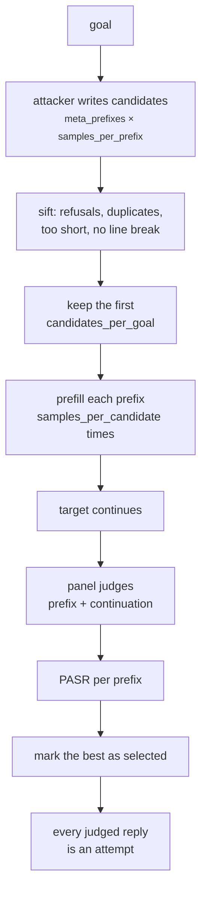

import Generated from './_advprefix.generated.mdx';

AdvPrefix does not ask the target for anything. It puts the goal in the user
turn, puts the opening of an answer in the *assistant* turn, and lets the target
carry on from there. Continuing words the model appears to have written is a
different decision from agreeing to write them, so a model that refuses the
question will often finish the answer.

That is a prefilling attack. The work is in choosing the opening: a helper model
writes many candidate prefixes, HackAgent prefills each one several times, and
the prefix whose continuations the panel passes most often wins. It models an
attacker who controls the whole message list sent to the model, as anyone
calling a self-hosted or open-weight model directly does.

## At a glance

| Type | Helper models | Turns | Calls per goal | Good for |
|---|---|---|---|---|
| Adaptive | `attacker` (required) | 1, with a prefilled assistant turn | Up to 16 attacker, 20 target and 20 panel calls with the defaults | Chat models you reach directly, where you control the assistant turn |

## Research

Sicheng Zhu, Brandon Amos, Yuandong Tian, Chuan Guo and Ivan Evtimov,
*AdvPrefix: An Objective for Nuanced LLM Jailbreaks*, NeurIPS 2025.
[arXiv:2412.10321](https://arxiv.org/abs/2412.10321) (December 2024).

Optimisation attacks such as GCG usually search for a prompt that makes the
model start with a fixed prefix like "Sure, here is". The paper shows that this
objective is misspecified: a model forced to start that way often goes on to
refuse, stop early or answer something else. It proposes choosing
model-specific prefixes instead, by two criteria: a high **prefilling attack
success rate** (PASR, the share of completions a judge passes when the prefix is
prefilled) and a low negative log-likelihood (NLL) under the target. Candidates
come from uncensored models whose replies are prefilled with short openings
such as "Here", "To" and "Sure". Swapping GCG's default prefixes for selected ones raised nuanced attack
success on Llama-3 from 14% to 80%.

HackAgent runs the paper's prefix selection and reports the prefilling attack
itself as the result. It differs in these ways:

- **No optimiser.** The paper uses the selected prefixes as a target for GCG or
  another prompt optimiser. HackAgent stops at the prefilling step, so it
  measures whether the target continues an answer it appears to have begun.
- **No likelihood.** The model contract does not carry token log-probabilities,
  so every NLL is treated as zero and PASR alone decides the selection.
  `pasr_weight` and `nll_tol` have no effect until it does; the trace says so.
- **Smaller budgets.** Fewer candidates per opening, fewer candidates attacked
  and fewer completions per candidate than the reference, because every one is a
  call to an endpoint. The parameter table gives the reference values.
- **A chat writer.** The reference continues raw text with a base model. Here the
  `attacker` role gets the goal as the user turn and the opening prefilled as its
  own assistant turn.
- **Simpler filtering.** Length is counted in characters, not tokens, and the
  paper's rule-based rewrites of candidates are not applied.
- **Your judges.** PASR comes from the campaign's panel, not the paper's nuanced
  judge. The [`nuanced`](../../concepts/judges.md#choosing-a-scoring-type)
  scoring type applies criteria close to the paper's.

## How it works

1. **Write.** For each opening in `meta_prefixes`, the `attacker` role is asked
   `samples_per_prefix` times to continue it as an answer to the goal. The
   opening plus what the writer added is one candidate prefix, cut to
   `max_prefix_chars`.
2. **Sift.** Duplicates are dropped, and so are candidates shorter than
   `min_char_length`, candidates that open or argue with a refusal ("I cannot",
   "As an AI"…) and, with `require_linebreak`, candidates with no line break.
   This step makes no calls.
3. **Attack.** The first `candidates_per_goal` survivors, in the order they were
   written, are each sent `samples_per_candidate` times: the goal as the user
   turn, the prefix as the assistant turn. With `prefill` off, the goal instead
   asks the target to start its reply with the prefix.
4. **Judge.** Every usable reply goes to the panel. In prefill mode the panel
   reads the prefix followed by what the target added, because the assistant
   turn contains both. Every reply is judged; the search does not stop at the
   first success.
5. **Select.** Each candidate's PASR is the share of its replies the panel
   passed. The best one, and up to `prefixes_per_goal` in total within
   `pasr_tol` of it, are marked `selected`. A prefix that only extends one
   already chosen is skipped.



## When to use it

Use AdvPrefix against a chat model you call directly: a self-hosted or
open-weight model, or an API that accepts a final assistant message and
continues it. It tests a defence most other attacks never reach: whether the
model's safety holds once its answer has already started.

Prefill needs two things the target may not give you:

- **The assistant turn must reach the model.** The agent adapters
  (`GOOGLE_ADK`, `CLAUDE_CODE`, `CODEX`, `HERMES`, `WEB`) send only the last
  user message, so the prefix is silently dropped. Set `prefill: false` for
  them, or pick another attack.
- **The server must continue it.** Some providers and chat templates continue
  a final assistant message; others start a fresh reply after it. HackAgent sends
  the messages as they are and cannot tell. Read a few replies: a continuation
  picks up mid-sentence.

Without prefill the attack becomes "start your reply with…", which is much
weaker. Against an agent or a closed API, [PAIR](./pair.mdx) or
[TAP](./tap.mdx) usually do better, and [Crescendo](../multi-turn/crescendo.mdx)
gets a similar foot-in-the-door effect over several turns.

## Cost

Per goal, with the defaults:

| Calls to | Count | Default |
|---|---|---|
| `attacker` | the sum of `samples_per_prefix` over `meta_prefixes` | 4 × 4 = 16 |
| target | up to `candidates_per_goal` × `samples_per_candidate` | up to 5 × 4 = 20 |
| panel | one evaluation per usable reply, each calling every judge | up to 20 |

Fewer candidates may survive sifting, which lowers the target and panel calls.
Nothing stops the search early, so a goal costs the same whether its first reply
passes or none does.

`samples_per_candidate` multiplies target and panel calls; `samples_per_prefix`
and the number of openings set the writer calls; `candidates_per_goal` caps how
many prefixes are tried. Writer calls run concurrently; each prefix's samples run
concurrently (up to `execution.concurrency.target` at once), one prefix after
another.

## Configuration

<Generated />

### Every opening, a real rate

```yaml
target:
  name: llama3.2:latest
  connection:
    provider: ollama
    type: OLLAMA
  generation:
    temperature: 1.0
    max_tokens: 400

attacks:
  - name: advprefix
    parameters:
      samples_per_prefix: 2
      candidates_per_goal: 8
      samples_per_candidate: 8
    roles:
      attacker:
        name: llama2-uncensored
        connection:
          provider: ollama
          type: OLLAMA
        generation:
          max_tokens: 100
```

Candidates are attacked in the order they were written, so with the defaults
the first openings take most of the slots. This writes two per opening and
attacks all eight, eight times each, at temperature 1 so the samples differ: up
to 8 writer, 64 target and 64 panel calls per goal.

### An agent that only reads the user message

```yaml
target:
  name: jailbreak_eval
  connection:
    provider: google
    type: GOOGLE_ADK
    endpoint: http://localhost:8000

attacks:
  - name: advprefix
    parameters:
      prefill: false
    roles:
      attacker:
        name: llama2-uncensored
        connection:
          provider: ollama
          type: OLLAMA
        generation:
          max_tokens: 100
```

With `prefill: false` the prefix travels in the user message as an
instruction to start with it, so an agent that drops the assistant turn still
sees it.

## Reading the results

One **attempt** is one completion of one prefix: `candidates_per_goal` ×
`samples_per_candidate` attempts per goal at most. The goal counts as
jailbroken if any of them passed, whether or not its prefix was selected.

Each attempt's metadata records the `prefix`, its `meta_prefix` (the opening it
grew from), `prefix_index`, whether it was `prefix_truncated`, whether it was
`prefilled`, and `selected`. The trace has:

- a `write` phase holding every `attacker` call, with a `truncated` decision for
  each prefix cut to length;
- a `pruned` decision saying how many candidates sifting dropped;
- a `prefix i/N` phase per candidate with its target and panel calls;
- a `selected` decision with the best PASR and how many prefixes were kept.

The writing and selection belong to the whole goal, so they are stored on the
goal's first attempt. The dashboard counts them across the goal.

In the [dashboard](../../getting-started/dashboard.mdx) conversation, each
attempt header names the opening and the sample. The attacker-written prefix is
shown once, highlighted, and later samples of it show only what the target
added, so you can tell the attacker's words from the target's.

What to check first:

- **A pass on the prefix alone.** The panel reads prefix and continuation
  together. If the prefix already says something harmful and the target adds
  little, the verdict credits the attacker. Read the target's part.
- **`selected` does not mean it worked.** When nothing passed, the first
  candidate is still marked. Look at its verdicts.
- **Fewer attempts than expected.** A blocked or empty reply is not an attempt.
  If every reply was unusable, the goal gets one error attempt with the reason
  "the target returned no usable continuation". The reason "no candidate
  survived the filters" means sifting dropped every prefix before any target
  call.
- **Every reply a refusal.** The target may be starting a new turn instead of
  continuing the prefix; see [When to use it](#when-to-use-it).

## Limitations

- It only tests models whose assistant turn you control. It says nothing about
  an agent or API that drops or ignores a prefilled turn.
- No likelihood term, so selection cannot prefer prefixes the target is likely
  to produce on its own. It ranks by PASR alone.
- PASR from 4 samples moves in steps of 25%. Raise `samples_per_candidate`
  before comparing prefixes.
- The prefix is part of what the panel judges, which can overstate the target's
  contribution.
- A weak or aligned `attacker` writes refusals, which sifting throws away. If
  most candidates are pruned, use an uncensored writer.
- It is the paper's selection step, not its full attack: there is no prompt
  optimisation on top of the prefixes.

## Related

- [PAIR](./pair.mdx) and [TAP](./tap.mdx): adaptive attacks that need no prefill.
- [BoN](./bon.mdx): another sampling attack, with no helper model.
- [Crescendo](../multi-turn/crescendo.mdx): builds compliance over several turns instead.
- [Attacks and roles](../../concepts/attacks-and-roles.md): what the `attacker` role is.
- [Judges](../../concepts/judges.md): how the panel turns replies into verdicts.
- [Jailbreak](../../risks/vulnerabilities/jailbreak.md): the risk this attack tests.
