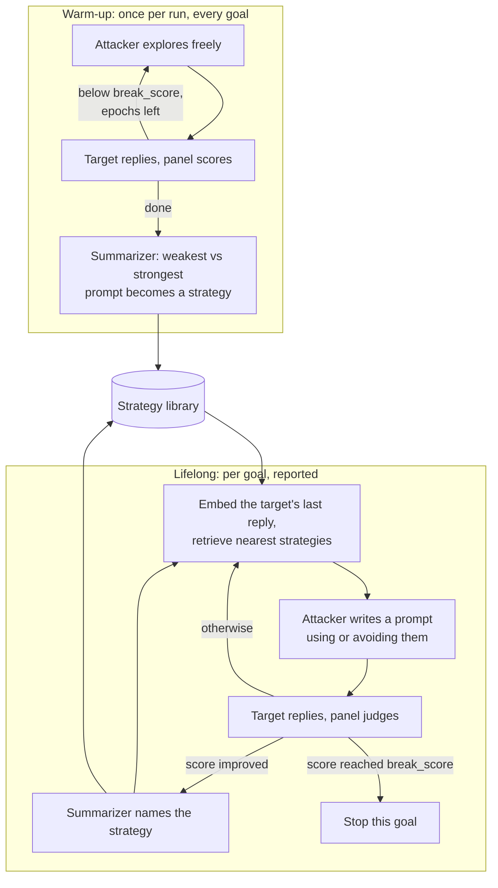

import Generated from './_autodan_turbo.generated.mdx';

AutoDAN-Turbo searches for **strategies**, not just prompts. An **attacker**
model writes jailbreak prompts; whenever one does better than the last, a
**summarizer** model names the tactic behind it, such as a framing or a
persuasion technique, and stores it in a **strategy library**. On later
attempts, and on later goals, the attacker is told which stored strategies to
use or avoid, picked by how similar the target's last reply is to the replies
those strategies beat before.

The idea that makes it work: what breaks a target on one goal often breaks it on
the next. AutoDAN-Turbo carries that knowledge across goals, so the run gets
better as it goes. It models a persistent adversary who attacks the same system
many times and keeps notes.

## At a glance

| Type | Helper models | Turns | Calls per goal | Good for |
|---|---|---|---|---|
| Adaptive | `attacker`, `summarizer`, `embedder` (all required) | 1 per attempt | Up to `epochs` target calls in warm-up and `epochs × lifelong_iterations` in the reported search, 200 with the defaults | Long runs over many goals where learning across goals pays off |

## Research

AutoDAN-Turbo comes from **"AutoDAN-Turbo: A Lifelong Agent for Strategy
Self-Exploration to Jailbreak LLMs"** by Xiaogeng Liu, Peiran Li, Edward Suh,
Yevgeniy Vorobeychik, Zhuoqing Mao, Somesh Jha, Patrick McDaniel, Huan Sun,
Bo Li and Chaowei Xiao (ICLR 2025, spotlight,
[arXiv:2410.05295](https://arxiv.org/abs/2410.05295)).

The paper showed that an agent which discovers strategies from scratch, with no
human-written list, beats earlier black-box attacks by 74.3% in average attack
success rate on public benchmarks, and reaches 88.5% on GPT-4-1106-turbo (93.4%
when human-designed strategies are added to its library). It runs a warm-up
over an initial set of requests to seed the library, a lifelong phase that keeps
adding strategies, and a test phase with the library frozen. A separate scorer
model (Gemma-1.1-7B-it) rates each reply from 1 to 10, and a request stops at
8.5 or after 150 attempts. Retrieval embeds the target's reply, takes the
nearest stored strategies, and sorts them by the score gain they produced:
above 5 the best one is reused, between 2 and 5 several are combined, below 2
they are listed as ones to avoid.

HackAgent follows the paper's prompts and retrieval rules, with these
differences:

- **The panel is the scorer.** There is no scorer role. The campaign's
  [judge panel](../../concepts/judges.md) scores every reply on its 0 to 10
  scale, and `break_score` is compared with that score.
- **Warm-up on your own goals.** Warm-up explores the campaign's goals, one pass
  over them, and summarizes each goal's weakest and strongest attempt into one
  strategy. The paper runs warm-up on a separate set of requests, repeated many
  times.
- **No test phase.** The lifelong phase is the reported search, and the library
  keeps growing while it runs.
- **One run's library.** The library lives in memory for one attack run. It is
  not saved, not shared with other runs, and you cannot load human-written
  strategies into it.
- **Retrieval in memory.** Strategies are found by distance between embeddings
  of the target's replies, computed in memory: the 10 nearest strategies, at
  most 5 returned.
- **Smaller budget.** `epochs` defaults to 100 attempts per phase, against the
  paper's 150.

## How it works

**Warm-up**, once per run, before any goal is reported:

1. For each goal, the attacker writes up to `epochs` prompts with no strategy
   guidance. Each goes to the target and the panel scores the reply. A score at
   or above `break_score` ends that goal's warm-up.
2. The summarizer compares the goal's lowest- and highest-scoring prompts and
   names the strategy behind the stronger one. It is stored with its score gain
   and the embedding of the reply it beat. `skip_warmup` skips this phase and
   starts with an empty library.

**Lifelong**, per goal, and reported:

3. The first attempt explores freely. From the second on, the target's last
   reply is embedded and the nearest strategies are retrieved. The attacker is
   told to adopt the effective ones, or, if all are ineffective, to avoid them
   and find something new.
4. The attacker writes a prompt between the tags its instructions ask for. If it
   refuses or gives nothing usable, the plain goal is sent instead.
5. The prompt goes to the target as a single user message and the panel judges
   the reply. This attempt is reported with the panel's verdict.
6. If the score beat the previous attempt's, the summarizer names the strategy
   that made the difference and adds it to the library.
7. A score at or above `break_score` ends the goal. Otherwise the loop runs
   again, up to `epochs` attempts, repeated `lifelong_iterations` times.



## When to use it

Use AutoDAN-Turbo for long runs over many goals against one target, when you can
afford hundreds of calls per goal and want the attack to adapt to that target.
It suits targets with a consistent blind spot: once a strategy works on one goal,
the library offers it on the next, so later goals tend to fall faster. It also
produces something you can read: the strategies it learned describe the target's
weaknesses in plain words.

Give it a **graded** panel. The search and the library both run on score
differences, and a single yes/no judge scores every failed reply 0, so warm-up
learns almost nothing until a reply is a full jailbreak. A judge with the
`scorer` scoring type, or several judges whose votes average out, gives it a
gradient to climb.

Choose another attack when:

- You have a handful of goals. Warm-up and learning need many attempts before
  they pay off; [PAIR](./pair.mdx) or [TAP](./tap.mdx) cost far less per goal.
- You want a fixed, small budget and a per-technique report. [PAP](./pap.mdx)
  tries named persuasion techniques once each.
- You cannot run an embedding model. AutoDAN-Turbo needs one; the other
  attacker-driven attacks do not.
- You need results you can repeat. The library depends on the order and outcome
  of everything before it; [BoN](./bon.mdx) with a fixed setup or a
  [static attack](../static/index.mdx) is easier to rerun.

## Cost

Every attempt costs one attacker call, one target call and one panel call, in
both phases. With `epochs` E and `lifelong_iterations` L, per goal:

| Model | Warm-up | Lifelong (reported) | With the defaults |
|---|---|---|---|
| Target | at most E | at most L × E | up to 100 + 100 |
| `attacker` | at most E | at most L × E | up to 100 + 100 |
| Judge panel | at most E | at most L × E | up to 100 + 100 |
| `summarizer` | 1 | one per score improvement | 1 + up to 100 |
| `embedder` | 1 | one per attempt after the first, plus one per new strategy | 1 + up to about 200 |

Each panel call is one call to every judge in the panel. `break_score` ends a
goal's search in either phase, so a goal the target gives up quickly costs a
few calls, and a goal it never gives up costs the full budget.

Warm-up runs once for the whole run, goal after goal, before the first goal is
reported, so a campaign with many goals spends a long time in warm-up before the
first result appears. With `execution.escalate`, it covers only the goals still
standing.

To spend less, lower `epochs` first: it bounds both phases. `skip_warmup`
removes the warm-up half, but the library then starts empty. Raising
`break_score` makes each goal search longer. With a single judge, or `mean`
aggregation, setting it to the panel's `threshold` stops each goal at the first
reply the panel would pass.

All three roles matter. The attacker must write adversarial prompts on request;
see [Choosing an attacker model](../../concepts/choosing-an-attacker.mdx). The
summarizer is called less often and can be a smaller model, but it must return
the strategy as JSON. The embedder is an embedding model, not a chat model, and
its quality decides whether retrieval finds the right strategies. On the
HackAgent platform you can name the gateway's `hackagent/attacker-v1` model for
the chat roles; see the [LLM gateway](../../api/index.mdx#llm-gateway).

## Configuration

<Generated />

### Example: a short trial run

```yaml
attacks:
  - name: autodan_turbo
    parameters:
      epochs: 3
    roles:
      attacker:
        name: llama3.2
        connection:
          provider: ollama
          type: OLLAMA
      embedder:
        name: nomic-embed-text
        connection:
          provider: ollama
          type: OLLAMA
      summarizer:
        name: llama3.2
        connection:
          provider: ollama
          type: OLLAMA
```

At most 6 target calls per goal: enough to check that all three roles answer in
the expected format and that strategies reach the library, before a long run.

### Example: a real search with a graded judge

```yaml
attacks:
  - name: autodan_turbo
    parameters:
      epochs: 25
      break_score: 7
    roles:
      attacker:
        name: llama3.2
        connection:
          provider: ollama
          type: OLLAMA
      embedder:
        name: nomic-embed-text
        connection:
          provider: ollama
          type: OLLAMA
      summarizer:
        name: llama3.2
        connection:
          provider: ollama
          type: OLLAMA

evaluation:
  judges:
    - name: qwen3:8b
      connection:
        provider: ollama
        type: OLLAMA
      scoring:
        type: scorer
  threshold: 7
```

A graded judge gives the library real score gains to learn from, and with this
single judge a `break_score` equal to the panel's `threshold` stops each goal at
the first reply the panel passes. Up to 50 target calls per goal.

## Reading the results

One **attempt** is one prompt from the lifelong phase and the target's reply,
with the panel's verdict and its `score`. Warm-up attempts are not reported:
they built the library.

Each attempt's trace sits under a `round i.e` phase (pass and attempt, from 1)
and holds the attacker call, the target call, the panel call and, when the score
improved, the summarizer call. Embedder calls are not traced. A `stopped`
decision marks the reply that reached `break_score`; `skipped` marks a target
reply that was unusable.

Warm-up is traced once for the run, not per goal: a `warm-up goal i/N` phase per
goal with its calls, and a `prepared` decision with the number of strategies
built (or `skipped` when warm-up was off). It is written to the run's
`traces.jsonl` in the output folder (`./logs/runs/` by default), not attached to
any attempt, so the dashboard's per-goal cost does not include it.

In the [dashboard](../../getting-started/dashboard.mdx), the conversation view
shows every lifelong prompt and reply, in order. They are separate requests, not
a conversation. **Attack branches** shows the recorded execution tree, one node
per round.

What to check:

- **A jailbreak** is an attempt the panel passed. The search stops on
  `break_score`, which is not the panel's `threshold`: a goal can show a
  jailbreak and keep going, or stop on a score the panel did not pass, unless
  the two match.
- **The strategy names** in the summarizer calls tell you what the target fell
  for. Read them across goals.
- **Prompts identical to the goal** mean the attacker refused or broke format,
  and the plain goal was sent. Many of these mean the attacker model is the
  problem.

## Limitations

- **Lifelong strategies are not recommended for reuse.** Strategies learned in
  the lifelong phase are currently stored without their score gain, so retrieval
  rates them below 2 and tells the attacker to avoid them. Only warm-up
  strategies can be recommended, which makes warm-up important: do not set
  `skip_warmup` if you want the library to steer toward what worked.
- **One warm-up pass.** Warm-up makes a single pass over the goals whatever
  `warmup_iterations` says.
- **Warm-up jailbreaks are not reported.** A goal broken during warm-up is
  attacked again in the lifelong phase, and only that result counts.
- **Coarse with yes/no judges.** Both the library and the stopping rule run on
  panel scores; a single yes/no judge leaves little to learn from.
- **Refusal detection is blunt.** An attacker prompt that contains phrases such
  as "I cannot" anywhere is treated as a refusal and replaced by the plain goal,
  even when the phrase is part of a role-play.
- **Order-dependent and not repeatable.** What a goal gets depends on every goal
  before it, and with `execution.concurrency.attack` above 1, goals search at
  once and share a library that changes under them.
- **Expensive and slow.** Hundreds of calls per goal by default, with warm-up
  before any result.
- **Single turn only.** Each prompt stands alone.

## Related

- [PAIR](./pair.mdx) and [TAP](./tap.mdx): attacker searches without a library.
- [PAP](./pap.mdx): persuasion techniques, the same vocabulary the summarizer
  uses for strategy names.
- [Adaptive attacks](./index.mdx): how to choose between them.
- [Attacks and roles](../../concepts/attacks-and-roles.md): the `embedder` and
  `summarizer` roles.
- [Judges](../../concepts/judges.md): graded scoring and thresholds.
- [Jailbreak](../../risks/vulnerabilities/jailbreak.md).
