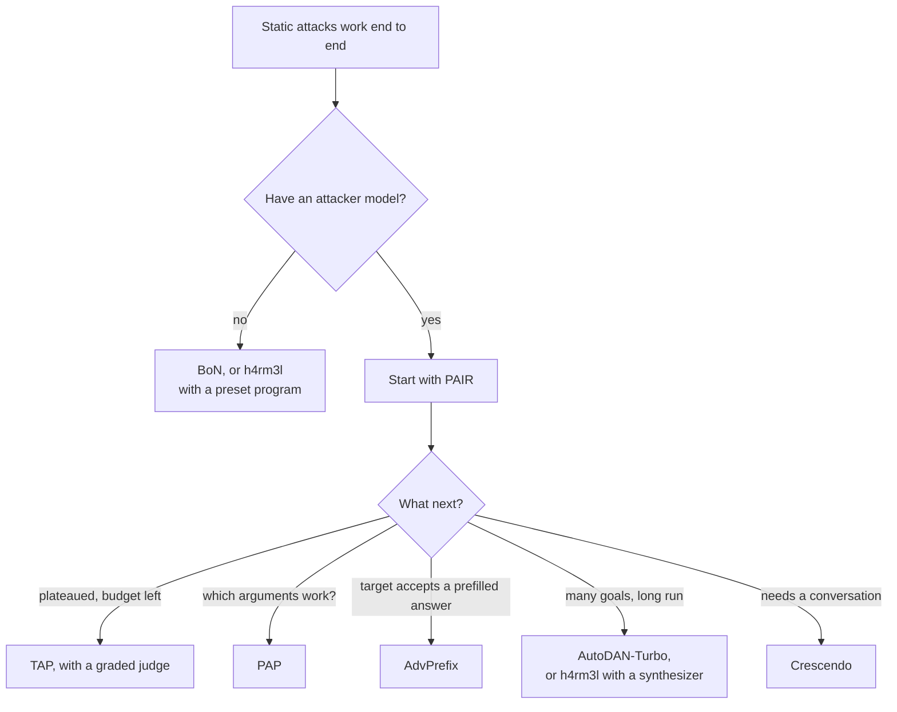

import AttackList from './_list.generated.mdx';

An adaptive attack **searches**. It sends a prompt, reads the target's reply and
what the judges made of it, and uses that to choose the next prompt. It keeps
going until a reply counts as a jailbreak or its budget runs out.

Every attempt is a separate, single request: the target never sees earlier
attempts. That is what sets these attacks apart from
[multi-turn attacks](../multi-turn/index.mdx), which build one conversation, and
from [static attacks](../static/index.mdx), which send a fixed transformation of
the goal and never look at the reply.

## What they have in common

**The judge panel is in the loop.** A static attack is judged after the fact.
An adaptive attack asks the campaign's [judge panel](../../concepts/judges.md)
about each reply while it searches, because the verdict tells it when to stop.
Most stop at the first reply the panel passes, so a goal that falls quickly
costs little; AdvPrefix always spends its full budget.
Two attacks use a score instead of the verdict: [PAIR](./pair.mdx) with its
optional `scorer` role, and [AutoDAN-Turbo](./autodan_turbo.mdx), which stops
on `break_score`. With no judges configured, a search has nothing to stop on and
runs its full budget.

**Most drive a helper model.** [PAIR](./pair.mdx), [TAP](./tap.mdx),
[PAP](./pap.mdx), [AdvPrefix](./advprefix.mdx) and
[AutoDAN-Turbo](./autodan_turbo.mdx) need an `attacker` model that writes
adversarial text on request, and the attacker you choose decides most of the
result. [BoN](./bon.mdx) needs none: it perturbs the goal at random.
[h4rm3l](./h4rm3l.mdx) needs none to run a fixed program, and only searches
when you give it a `synthesizer` role. See
[Attacks and roles](../../concepts/attacks-and-roles.md) and
[Choosing an attacker model](../../concepts/choosing-an-attacker.mdx).

**Cost is a dial.** Each attack's parameters set how many attempts it may make
per goal, and every attempt costs a target call, a panel call (one call per
judge) and usually a helper-model call. More attempts find more jailbreaks and
cost more. Each attack page has a Cost section with the exact counts.

**Scores matter, not just verdicts.** TAP prunes its tree by panel score, and
AutoDAN-Turbo learns from score differences. A single yes/no judge scores every
failed reply 0, which leaves them nothing to rank. Give those two a judge with
the `scorer` scoring type, or several judges.

**Some learn across goals.** AutoDAN-Turbo builds a strategy library and h4rm3l
(with a synthesizer) builds a pool of programs once per run, before the first
goal is reported. What one goal teaches, the next goal uses.

**Results vary between runs.** Helper models and random perturbations sample, so
the same campaign can break different goals each time. Compare success rates
over many goals, not single goals.

Every attempt is recorded with its prompt, reply, verdict and trace, so you can
read the search in the [dashboard](../../getting-started/dashboard.mdx).

## The attacks

<AttackList />

## Choosing between them

What each one searches over, and what it costs with its default parameters:

| Attack | Searches over | Target calls per goal, defaults | Learns across goals |
|---|---|---|---|
| [BoN](./bon.mdx) | Random character-level perturbations of the goal | up to 20 | no |
| [h4rm3l](./h4rm3l.mdx) | Obfuscation programs; only with a `synthesizer` | 1 without a synthesizer; with one (and judges), up to 240 for the whole run, then up to 3 | with a synthesizer |
| [PAP](./pap.mdx) | Persuasion techniques, one rewrite each | up to 5 | no |
| [AdvPrefix](./advprefix.mdx) | Openings prefilled into the target's answer | 20, no early stop | no |
| [PAIR](./pair.mdx) | Prompts refined by parallel attacker conversations | up to 25 | no |
| [TAP](./tap.mdx) | A tree of refined prompts, pruned twice a round | up to 36 | no |
| [AutoDAN-Turbo](./autodan_turbo.mdx) | Strategies, stored and retrieved across goals | up to 200, half of it in warm-up | yes |

- **No attacker model yet?** Use [BoN](./bon.mdx), which needs no helper
  model, or [h4rm3l](./h4rm3l.mdx) with a preset program, which costs one call
  per goal like a static attack.
- **Start with [PAIR](./pair.mdx).** It is the cheapest attacker-driven search,
  and its prompts are readable.
- **Move to [TAP](./tap.mdx)** when PAIR plateaus and you can spend more. It
  explores several refinements of every promising prompt. Give it a graded
  judge.
- **Use [PAP](./pap.mdx)** for the smallest fixed budget and a per-technique
  answer to which kinds of persuasion the target accepts.
- **Use [AdvPrefix](./advprefix.mdx)** when the target's API lets you prefill
  the start of its answer, as many open-weight models do. It tests whether a
  model that refuses the question will still finish an answer it appears to
  have begun.
- **Use [AutoDAN-Turbo](./autodan_turbo.mdx)** for long runs over many goals,
  where learning on one goal helps the next. Use h4rm3l with a `synthesizer` for
  the same idea applied to obfuscation programs.
- **Use [Crescendo](../multi-turn/crescendo.mdx)** when a target resists every
  single request but might give way across a conversation.

To run several of them economically, list them from cheapest to most expensive
and turn on [`execution.escalate`](../../cli/campaign-files/execution.md#executionspec):
each attack then faces only the goals the earlier ones did not break.
