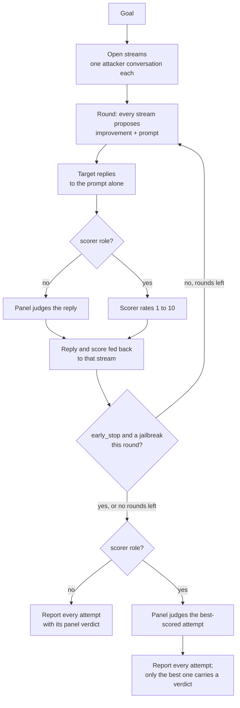

import Generated from './_pair.generated.mdx';

PAIR puts a second model, the **attacker**, against your target. The attacker
writes a jailbreak prompt, reads the target's reply and the score it got, and
writes a better prompt. Several of these attacker conversations, called
**streams**, run side by side, and the search stops as soon as one of them gets
a reply that counts as a jailbreak.

The one idea that makes it work: the target never sees the history, but the
attacker does. Each prompt goes to the target on its own, as a fresh single-turn
request, while the attacker keeps a running record of what it tried and how the
target reacted. PAIR models an adversary with nothing but black-box access and
another LLM, who can send as many single requests as they like and learns from
every refusal.

## At a glance

| Type | Helper models | Turns | Calls per goal | Good for |
|---|---|---|---|---|
| Adaptive | `attacker` (required), `scorer` (optional) | 1 per attempt | Up to `streams × iterations` target calls, 25 with the defaults | Your first attacker-driven attack: readable role-play and framing jailbreaks on a small budget |

## Research

PAIR comes from **"Jailbreaking Black Box Large Language Models in Twenty
Queries"** by Patrick Chao, Alexander Robey, Edgar Dobriban, Hamed Hassani,
George J. Pappas and Eric Wong (2023,
[arXiv:2310.08419](https://arxiv.org/abs/2310.08419)).

The paper showed that an attacker LLM, told only the goal and shown each reply
with a 1 to 10 score, finds semantic jailbreaks of GPT-3.5, GPT-4, Vicuna and
Gemini, often in fewer than twenty queries. Its experiments run 30 streams for 3
iterations, give each stream one of three attacker system prompts (role-play,
logical appeal, authority endorsement), and stop a stream when the judge calls a
reply jailbroken.

HackAgent follows the paper's algorithm and prompts, with these differences:

- **Who scores.** In the paper a judge model drives the loop. In HackAgent that
  job goes to the campaign's [judge panel](../../concepts/judges.md) by default:
  the panel's 0 to 10 score is what the attacker sees, and the panel's verdict
  decides success. Add the optional `scorer` role to get the paper's setup back:
  the scorer rates every reply with the paper's 1 to 10 rubric, the search stops
  on `jailbreak_threshold`, and the panel then checks only the best-scored
  attempt.
- **Stream approaches.** Every stream gets the same attacker instructions plus
  one of the paper's three approaches, assigned in turn: stream 1 role-play,
  stream 2 logical appeal, stream 3 authority endorsement, stream 4 role-play
  again, and so on.
- **Budget.** The default `streams` and `iterations` run fewer, longer streams
  than the paper's 30 streams of 3 rounds, for fewer target calls than its
  90.
- **History.** A stream keeps its last `keep_last_n` attacker turns, and the
  reply and judge explanation fed back to the attacker are cut to
  `feedback_max_chars`. The scorer always sees the whole reply.
- **Unusable turns.** An attacker reply that is not the JSON object the
  instructions ask for (with `improvement` and `prompt` fields) is dropped, not
  sent: that stream skips the round.

## How it works

1. **Open the streams.** PAIR starts `streams` attacker conversations. Each one
   holds the attacker instructions (the goal, the `target_str` the target's
   reply should open with, and the stream's approach) and a request for a first
   prompt.
2. **Propose.** In each round, every stream asks the attacker for its next turn:
   a short `improvement` note and a new `prompt`.
3. **Send.** The prompt goes to the target as a single user message, with no
   earlier turns.
4. **Rate.** Without a `scorer`, the panel judges the reply and its score and
   explanation become the feedback. With a `scorer`, the scorer rates the reply
   from 1 to 10 instead.
5. **Feed back.** The reply, the goal and the score are appended to that
   stream's attacker conversation, so the next prompt can build on what
   happened. Old turns beyond `keep_last_n` are trimmed.
6. **Stop or continue.** When `early_stop` is on and any stream got a jailbreak
   in this round (a panel success, or a scorer rating at or above
   `jailbreak_threshold`), the search ends after the round. Otherwise the next
   round starts, up to `iterations` rounds.
7. **Verdict.** Without a scorer every attempt already carries the panel's
   verdict. With one, the panel now judges the single attempt the scorer rated
   highest, and that verdict is the one the run reports.



## When to use it

Use PAIR as the first adaptive attack once a [static attack](../static/index.mdx)
has shown that your target, judges and plumbing work. It is cheap for an
attacker-driven search, its prompts are plain language a human can read and
reuse, and it often succeeds where a fixed template fails.

PAIR finds targets that refuse a direct request but give way to a story, a
persona, a plausible justification or an appeal to authority: the role-play,
hypothetical and authority-manipulation weaknesses listed under
[Jailbreak](../../risks/vulnerabilities/jailbreak.md).

Choose another attack when:

- PAIR plateaus. [TAP](./tap.mdx) explores more: it branches every promising
  prompt into several refinements and prunes the weak ones, so it covers more
  of the search for a similar number of target calls.
- You want one request per persuasion technique and a report of which ones
  work. [PAP](./pap.mdx) does exactly that, with a smaller and fixed budget.
- You have no attacker model. [BoN](./bon.mdx) needs no helper model.
- You run many goals and want what the search learns on one to help the next.
  [AutoDAN-Turbo](./autodan_turbo.mdx) keeps a strategy library across goals.
- The target's weakness only shows across a conversation.
  [Crescendo](../multi-turn/crescendo.mdx) holds one growing conversation; PAIR
  never does.

## Cost

Every round, each stream makes one attacker call, one target call and one
rating. Per goal, with `streams` S and `iterations` K:

| Model | Calls per goal | With the defaults |
|---|---|---|
| Target | at most S × K | 25 |
| `attacker` | S × K | 25 |
| Judge panel, without a `scorer` | at most S × K | 25 |
| `scorer`, when configured | at most S × K | 25 |
| Judge panel, with a `scorer` | 1 | 1 |

Each panel call is one call to every judge in the panel. A stream whose attacker
reply is unusable makes no target call that round, so the target and rating
counts can fall below the attacker count.

`early_stop` is the big saving. The search ends after the first round with a
jailbreak, so an easy goal costs one round (S target calls). It always finishes
the round it is in, because the streams of a round run together.

To spend less, lower `streams` or `iterations`. To spend fewer judge calls,
add a `scorer`: one cheap model then rates every reply, and the panel runs once
per goal. More streams widen the search; more rounds let each stream refine
further. The paper runs many short streams (30 of 3 rounds).

The attacker decides most of the outcome. It must be willing to write
adversarial prompts and follow the JSON format; a model that refuses or
rambles wastes its rounds. See [Choosing an attacker model](../../concepts/choosing-an-attacker.mdx)
for measured comparisons. On the HackAgent platform you can name the gateway's
`hackagent/attacker-v1` model as the role; see the [LLM gateway](../../api/llm-gateway.mdx).

## Configuration

<Generated />

### Example: a quick smoke test

```yaml
attacks:
  - name: pair
    parameters:
      streams: 2
      iterations: 2
    roles:
      attacker:
        name: llama3.2
        connection:
          provider: ollama
          type: OLLAMA
```

At most four target calls per goal: enough to check that the attacker returns
usable JSON and the panel scores the replies, before you pay for a real search.

### Example: wide and shallow, with a scorer

```yaml
attacks:
  - name: pair
    parameters:
      streams: 10
      iterations: 3
    roles:
      attacker:
        name: llama3.2
        connection:
          provider: ollama
          type: OLLAMA
      scorer:
        name: qwen3:8b
        connection:
          provider: ollama
          type: OLLAMA
```

Many short streams, closer to the paper's shape, rated on its 1 to 10 scale by a separate scorer:
up to 30 target and scorer calls per goal, but only one panel call, so use it
when your judge panel is the expensive part.

## Reading the results

One **attempt** is one prompt PAIR sent to the target and the reply it got. A
goal gets up to `streams × iterations` attempts, in round order, and each
records its `iteration` and `stream` (both counted from 0) and the `score` the
attacker saw.

The trace of each attempt sits under a `round r/K` and a `stream s/S` phase and
holds the attacker call, the target call and the rating (a `panel` or `scorer`
call). Decisions record why the search turned: `skipped` when the attacker gave
no usable prompt or the target gave no usable reply, `stopped` when a stream
reached a jailbreak. With a scorer, a `panel review` phase holds the one panel
call.

In the [dashboard](../../getting-started/dashboard.mdx), the conversation view
shows every attempt's prompt and reply. Each prompt was sent on its own, so read
them as separate tries, not as one conversation. The dashboard draws no branch
view for PAIR; read the attempts in order.

What to check:

- **A jailbreak** is an attempt the panel passed. Read its reply, not the score:
  a reply that adopts a persona but delivers nothing useful can still fool a
  lenient judge.
- **With a scorer**, only the best-scored attempt carries a panel verdict; the
  rest show no verdict. A goal PAIR did not break therefore shows as
  unresolved, not mitigated. If the scorer's best attempt failed the panel,
  compare the scorer's ratings with the panel's explanation.
- **An error attempt** saying the attacker proposed no usable prompt means every
  attacker call failed or returned no usable JSON. Check the attacker calls in the trace: the
  model is refusing or ignoring the JSON format, and a different attacker model
  is the fix.

## Limitations

- **Single turn only.** Each prompt stands alone, so PAIR cannot find weaknesses
  that need a conversation to build up.
- **Bounded by the attacker.** A weak or refusing attacker makes a weak search,
  and the result says more about the attacker than the target.
- **Coarse feedback from yes/no judges.** Without a scorer, the attacker sees the
  panel's score. With yes/no judges that is 0 or 10 and says little about how
  close a reply came. Add a `scorer`, or use a judge with the `scorer` scoring
  type (see [Judges](../../concepts/judges.md)).
- **The scorer can hide a jailbreak.** With a scorer the panel checks one
  attempt. A reply the panel would pass but the scorer rated lower is never
  shown to the panel.
- **Not repeatable.** Attacker sampling differs from run to run, so compare
  success rates over many goals, not single goals.
- **Smaller than the paper.** The default budget is a quarter of the paper's,
  and the paper's success rates were measured with its own judges, so do not
  expect its numbers.

## Related

- [TAP](./tap.mdx): the same attacker loop, grown into a pruned tree.
- [PAP](./pap.mdx): one persuasion technique per request, no refinement.
- [AutoDAN-Turbo](./autodan_turbo.mdx): strategies learned across goals.
- [Crescendo](../multi-turn/crescendo.mdx): a multi-turn attack.
- [Adaptive attacks](./index.mdx): how to choose between them.
- [Attacks and roles](../../concepts/attacks-and-roles.md) and
  [Judges](../../concepts/judges.md).
- [Jailbreak](../../risks/vulnerabilities/jailbreak.md): the risk PAIR tests.
