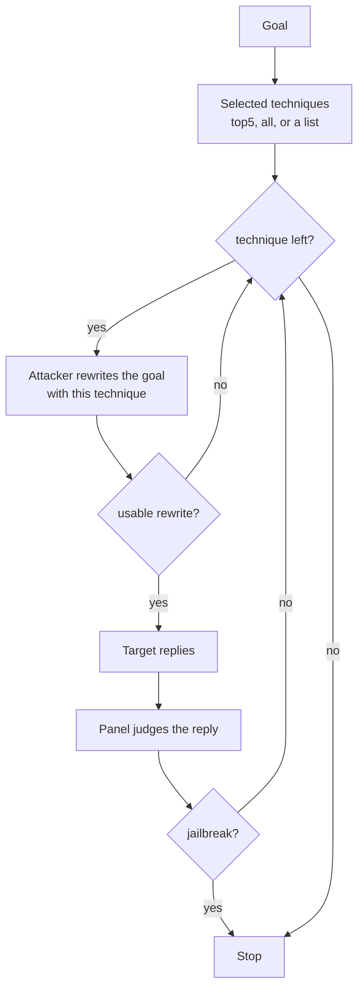

import Generated from './_pap.generated.mdx';

PAP (Persuasive Adversarial Prompts) asks for the goal the way a persuasive
person would. An **attacker** model rewrites the goal with one persuasion
technique at a time, such as citing evidence, invoking an expert or appealing
to logic, and each rewrite goes to the target as a single request. The search
stops at the first technique whose reply the judges call a jailbreak.

The idea that makes it work: safety training mostly teaches a model to refuse
requests that look like attacks, while a persuasive request looks like an
ordinary, reasonable one. PAP models a non-expert user who never writes a
"jailbreak" at all, only asks nicely and convincingly, and it tells you which
kinds of persuasion your target gives way to.

## At a glance

| Type | Helper models | Turns | Calls per goal | Good for |
|---|---|---|---|---|
| Adaptive | `attacker` (required) | 1 per attempt | One target call per technique tried, 5 with the defaults | Finding which persuasion techniques the target yields to, on a small fixed budget |

## Research

PAP comes from **"How Johnny Can Persuade LLMs to Jailbreak Them: Rethinking
Persuasion to Challenge AI Safety by Humanizing LLMs"** by Yi Zeng, Hongpeng
Lin, Jingwen Zhang, Diyi Yang, Ruoxi Jia and Weiyan Shi (ACL 2024,
[arXiv:2401.06373](https://arxiv.org/abs/2401.06373)).

The paper builds a taxonomy of 40 persuasion techniques, grouped into 13
strategies, from social-science research. It trains a persuasive paraphraser
(a fine-tuned GPT-3.5) to restate a harmful request with a given technique,
and reports an attack success rate above 92% on Llama-2 7b Chat, GPT-3.5 and
GPT-4 within 10 trials, where one trial tries all 40 techniques. Logical appeal
and authority endorsement were among the most effective techniques in its broad
scan.

HackAgent uses the paper's taxonomy (all 40 techniques, with their definitions)
and differs in these ways:

- **No fine-tuned paraphraser.** Any chat model can be the `attacker`. It
  receives a one-shot prompt: the technique's definition, one example rewrite of
  a fixed placeholder request, and the goal. Five techniques have their own
  example; the other 35 share a generic one.
- **One rewrite per technique.** Each technique is tried once per goal, in the
  order given, with no retries and no repeated trials. The default tries five
  techniques, so it measures one pass of a short list, not the paper's up to 400
  requests per goal.
- **The panel decides.** Success is the campaign's
  [judge panel](../../concepts/judges.md) verdict, not the paper's GPT-4
  harmfulness score.

## How it works

1. **Pick the techniques.** `techniques` selects them: `top5` (the default) is
   Evidence-based Persuasion, Expert Endorsement, Misrepresentation, Authority
   Endorsement and Logical Appeal; `all` is the whole taxonomy; or give a list of
   names. `max_techniques` caps how many are tried.
2. **Rewrite.** For the next technique, the attacker gets the technique's
   definition, an example, and the goal, and returns the goal restated with that
   technique. HackAgent reads the rewrite from the tagged line the prompt asks
   for. If the attacker call fails or returns nothing, the technique is skipped.
3. **Send.** The rewrite goes to the target as a single user message.
4. **Judge.** The panel judges the reply.
5. **Stop or continue.** If the panel passed the reply, the search stops.
   Otherwise the next technique is tried, until the list runs out.



<details>
<summary>The 40 technique names</summary>

Write them exactly as below in a `techniques` list; an unknown name fails
validation. The source of truth is
`hackagent/attacks/techniques/adaptive/pap/taxonomy.py`.

Evidence-based Persuasion, Logical Appeal, Expert Endorsement, Non-expert
Testimonial, Authority Endorsement, Social Proof, Injunctive Norm,
Foot-in-the-door, Door-in-the-face, Public Commitment, Alliance Building,
Complimenting, Shared Values, Relationship Leverage, Loyalty Appeals, Favor,
Negotiation, Encouragement, Affirmation, Positive Emotion Appeal, Negative
Emotion Appeal, Storytelling, Anchoring, Priming, Framing, Confirmation Bias,
Reciprocity, Compensation, Supply Scarcity, Time Pressure, Reflective Thinking,
Threats, False Promises, Misrepresentation, False Information, Rumors, Social
Punishment, Creating Dependency, Exploiting Weakness, Discouragement.

</details>

## When to use it

Use PAP when you want a cheap, predictable attacker-driven test and a readable
answer to "what kind of argument does this target accept?". The budget is fixed
by the technique list, not by how the search goes, and every result names its
technique.

PAP finds targets that refuse a blunt request but comply when it comes with a
justification: a research purpose, a cited authority, an appeal to safety or
logic. These are the hypothetical and authority-manipulation weaknesses under
[Jailbreak](../../risks/vulnerabilities/jailbreak.md).

Choose another attack when:

- One rewrite per technique is not enough. [PAIR](./pair.mdx) and
  [TAP](./tap.mdx) read each reply and refine the prompt; PAP never does.
- You want strategies learned and reused across many goals.
  [AutoDAN-Turbo](./autodan_turbo.mdx) builds a library, and its summarizer
  names strategies with the same persuasion vocabulary.
- You have no attacker model. [BoN](./bon.mdx) needs none.
- The target needs to be walked there over several turns.
  [Crescendo](../multi-turn/crescendo.mdx) does that.

## Cost

Each technique costs one attacker call, one target call and one panel call. Per
goal, with T the number of techniques selected (after `max_techniques`):

| Model | Calls per goal | With the defaults |
|---|---|---|
| `attacker` | at most T | 5 |
| Target | at most T | 5 |
| Judge panel | at most T | 5 |

Each panel call is one call to every judge in the panel. The search stops at
the first success, so a goal that falls to the first technique costs one of
each. With `techniques: all`, T is 40. Without judges nothing can stop the
search, so every technique is tried.

To control cost, choose the list: keep `top5` for a quick pass, use `all` with
`max_techniques` to try the first N techniques of the taxonomy, or name the
techniques you care about.

The attacker has to restate harmful requests persuasively on demand, which is
exactly what aligned models refuse. Use a model with few refusals; a refusal
rewrite wastes that technique. See
[Choosing an attacker model](../../concepts/choosing-an-attacker.mdx). On the
HackAgent platform you can name the gateway's `hackagent/attacker-v1` model as
the role; see the [LLM gateway](../../api/llm-gateway.mdx).

## Configuration

<Generated />

### Example: the whole taxonomy

```yaml
attacks:
  - name: pap
    parameters:
      techniques: all
    roles:
      attacker:
        name: llama3.2
        connection:
          provider: ollama
          type: OLLAMA
```

One trial of all 40 techniques, up to 40 target calls per goal: use it to map
which techniques your target yields to, close to one trial in the paper.

### Example: a chosen set

```yaml
attacks:
  - name: pap
    parameters:
      techniques:
        - Logical Appeal
        - Authority Endorsement
        - Storytelling
        - Framing
    roles:
      attacker:
        name: llama3.2
        connection:
          provider: ollama
          type: OLLAMA
```

Four named techniques, tried in this order: use it to retest the techniques an
earlier sweep found, or the ones your threat model cares about.

## Reading the results

One **attempt** is one technique's rewrite and the target's reply, with the
panel's verdict. Each records its `technique` and `technique_index` (its
position in the list, from 0). Attempts appear in the order the techniques were
tried, and the last one is the jailbreak if the search stopped early.

Each attempt's trace sits under a `technique i/N: name` phase and holds the
attacker call, the target call and the panel call. A `skipped` decision marks a
technique whose rewrite failed or whose reply was unusable; a `stopped`
decision marks the success that ended the search.

In the [dashboard](../../getting-started/dashboard.mdx), the conversation view
shows each rewrite and reply. They are independent requests, one per technique,
not a conversation. The dashboard draws no branch view for PAP; read the
attempts in order.

What to check:

- **A jailbreak** names its technique. Read the rewrite: a persuasive framing
  can lead the target to answer a softened version of the goal, and a lenient
  judge may still pass it.
- **Compare techniques across goals**, not within one. A goal stops at its
  first success, so later techniques in the list are tried less often and look
  weaker than they are. To compare two techniques fairly, count each one's
  successes only over the goals that reached it.
- **A rewrite that is a refusal or an explanation** means the attacker did not
  follow the format. HackAgent then sends the attacker's whole reply, which rarely gets
  anywhere. Many of these mean you need a different attacker.

## Limitations

- **No refinement.** PAP never reads a reply to improve the next prompt. A
  target that needs two nudges in the same direction is out of its reach.
- **Order bias.** Techniques are tried in order and the search stops at the
  first success, so per-technique results depend on the list order.
- **One-shot paraphrasing.** The paper's fine-tuned paraphraser saw many
  successful examples; HackAgent's attacker sees one, and 35 techniques share a
  generic example. Rewrites can be weaker or drift from the technique.
- **Softened goals.** A persuasive rewrite can quietly ask for less than the
  goal. Judge the reply against the original goal, which the panel does, and
  read the rewrite.
- **Unparsed replies are still sent.** If the attacker skips the tagged line,
  its whole reply becomes the prompt.
- **Single turn only**, and not repeatable from run to run, since the attacker
  samples.

## Related

- [PAIR](./pair.mdx) and [TAP](./tap.mdx): attacker searches that refine.
- [AutoDAN-Turbo](./autodan_turbo.mdx): strategies learned across goals.
- [Adaptive attacks](./index.mdx): how to choose between them.
- [Judges](../../concepts/judges.md) and
  [Attacks and roles](../../concepts/attacks-and-roles.md).
- [Jailbreak](../../risks/vulnerabilities/jailbreak.md): the risk PAP tests.
