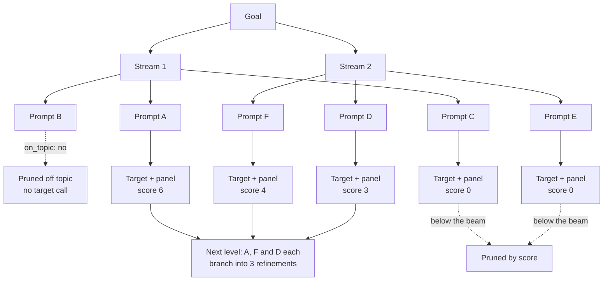

import Generated from './_tap.generated.mdx';

TAP (Tree of Attacks with Pruning) uses an **attacker** model to grow a tree of
jailbreak prompts. Every round, each surviving prompt is refined into several
variants. Variants that drifted away from the goal are dropped before they reach
the target, the rest are sent and judged, and only the best few go on to the
next round.

The idea that makes it work is branching plus pruning. Where
[PAIR](./pair.mdx) refines a fixed set of conversations one step at a time, TAP
tries several refinements of every promising prompt and keeps only the ones the
judges liked, so the search spends its target calls where progress is being
made. Like PAIR, it models an adversary with black-box access who sends single,
independent requests and learns from every reply.

## At a glance

| Type | Helper models | Turns | Calls per goal | Good for |
|---|---|---|---|---|
| Adaptive | `attacker` (required), `on_topic` (optional) | 1 per attempt | Up to `branching_factor × (streams + (depth − 1) × width)` target calls, 36 with the defaults | A deeper attacker-driven search when PAIR plateaus |

## Research

TAP comes from **"Tree of Attacks: Jailbreaking Black-Box LLMs Automatically"**
by Anay Mehrotra, Manolis Zampetakis, Paul Kassianik, Blaine Nelson, Hyrum
Anderson, Yaron Singer and Amin Karbasi (NeurIPS 2024,
[arXiv:2312.02119](https://arxiv.org/abs/2312.02119)).

The paper builds on PAIR. It showed that branching each prompt into several
refinements and pruning twice per round (off-topic prompts before the target is
queried, low scorers after) jailbreaks GPT-4-Turbo and GPT-4o for more than 80%
of its prompts, and works against targets behind guardrails such as LlamaGuard.
On GPT-4 it reports 90% success with 28.8 queries on average, against 60% with
37.7 queries for PAIR. Its experiments use branching factor 4, width 10 and
depth 10, and one evaluator model (GPT-4) for both the off-topic check and the
1 to 10 score.

HackAgent follows the paper's algorithm and prompts, with these differences:

- **Two models instead of one evaluator.** The off-topic check is the optional
  `on_topic` role. Without it, no branch is pruned for drifting. The score that
  ranks branches is the campaign's [judge panel](../../concepts/judges.md) score
  on its 0 to 10 scale, and the panel's verdict decides success. TAP has no
  judge of its own.
- **A smaller tree.** The defaults are 4 streams, branching factor 3, width 4
  and depth 3, for at most 36 target calls per goal.
- **The prune never empties the tree.** A branch survives the score prune only
  if its score is above `min_prune_score`, but the best branch always survives,
  so one bad judging pass cannot end the search. Ties are broken at random.
- **Lenient on noise.** An `on_topic` answer that is neither yes nor no keeps
  the branch, and an attacker reply that is not the requested JSON is retried
  up to `max_attempts` times before that candidate is dropped.

## How it works

1. **Plant the roots.** TAP opens `streams` attacker conversations, each with
   the goal, the `target_str` the reply should open with, and a request for a
   first prompt.
2. **Branch.** Every surviving branch asks the attacker for `branching_factor`
   refinements. Each child copies its parent's conversation, so it builds on
   what the parent learned.
3. **Prune off topic.** With an `on_topic` role, each new prompt is checked
   against the goal, yes or no. Prompts that no longer ask for the goal are
   dropped before they cost a target call. If every prompt drifted, the search
   stops.
4. **Send and judge.** Each remaining prompt goes to the target as a single user
   message, and the panel judges the reply. The reply and its score are fed back
   into that branch's conversation.
5. **Stop on success.** With `early_stop` on, a round with any reply the panel
   passed ends the search.
6. **Prune by score.** Branches are ranked by panel score. Those above
   `min_prune_score` survive, at most `width` of them; if none is above it, the
   single best survives.
7. **Repeat.** Steps 2 to 6 run once per level, up to `depth` levels. Every
   prompt that reached the target is reported with its panel verdict.

The tree below shows one level with 2 streams and a branching factor of 3.



## When to use it

Use TAP when [PAIR](./pair.mdx) does not break a goal and you can afford a
larger search. It finds the same kind of weakness, a target that gives way to
role-play, framing or obfuscated wording, but explores several directions at
once and drops dead ends early. It is one of the attacks the
[Jailbreak](../../risks/vulnerabilities/jailbreak.md) risk recommends first.

TAP gets the most from a **graded** panel. Its score prune ranks branches by
panel score, and a single yes/no judge gives every failed reply 0, so nothing
distinguishes a near miss from a flat refusal. Use a judge with the `scorer`
scoring type, or several judges, whose votes average into partial scores.

Choose another attack when:

- You want the cheapest attacker-driven baseline. [PAIR](./pair.mdx) costs less
  per goal.
- You want to know which persuasion techniques work. [PAP](./pap.mdx) tries one
  per request and reports each.
- You have no attacker model. [BoN](./bon.mdx) needs none.
- Many goals share the same weakness. [AutoDAN-Turbo](./autodan_turbo.mdx)
  learns strategies on one goal and reuses them on the next.
- The weakness needs a conversation. [Crescendo](../multi-turn/crescendo.mdx)
  works across turns; TAP sends single requests.

## Cost

Each level sends every surviving candidate to the target once. The first level
expands the `streams` roots; every later level expands at most `width`
survivors. With `branching_factor` b, `streams` S, `width` W, `depth` D and
`max_attempts` M, per goal:

| Model | Calls per goal | With the defaults |
|---|---|---|
| Candidates written | at most b × (S + (D − 1) × W) | 36 |
| `attacker` | one to M per candidate | 36 to 108 |
| `on_topic`, when configured | one per candidate | 36 |
| Target | one per candidate kept on topic | at most 36 |
| Judge panel | one per target reply | at most 36 |

Each panel call is one call to every judge in the panel.

What lowers the count:

- **Early stop.** The search ends after the first level with a panel success.
- **Off-topic pruning.** Every dropped candidate saves a target call and a panel
  call, for the price of one `on_topic` call. Use a small, fast model for this
  role.
- **The score prune.** Fewer survivors mean fewer candidates next level. With a
  single yes/no judge and no success, only one branch survives each level, so a
  default search costs at most 12 + 3 + 3 = 18 target calls, but it also
  searches far less.

`depth` adds levels, `width` keeps more branches alive, and `branching_factor`
multiplies every level, so raise it last.

The attacker decides most of the outcome: it must write adversarial prompts in
the JSON format the instructions ask for. Calls it wastes on refusals or prose
are retried up to `max_attempts` times. See [Choosing an attacker model](../../concepts/choosing-an-attacker.mdx),
whose measurements include TAP. On the HackAgent platform you can name the
gateway's `hackagent/attacker-v1` model as the role; see the
[LLM gateway](../../api/index.mdx#llm-gateway).

## Configuration

<Generated />

### Example: a thorough search with both prunes

```yaml
attacks:
  - name: tap
    parameters:
      depth: 5
      width: 5
    roles:
      attacker:
        name: llama3.2
        connection:
          provider: ollama
          type: OLLAMA
      on_topic:
        name: llama3.2:1b
        connection:
          provider: ollama
          type: OLLAMA

evaluation:
  judges:
    - name: qwen3:8b
      connection:
        provider: ollama
        type: OLLAMA
      scoring:
        type: scorer
```

A deeper, wider tree with a small model pruning drifted prompts, and a graded
judge so the score prune can tell a near miss from a refusal. Up to
3 × (4 + 4 × 5) = 72 target calls per goal.

### Example: a cheap first look

```yaml
attacks:
  - name: tap
    parameters:
      streams: 2
      branching_factor: 2
      width: 2
      depth: 2
    roles:
      attacker:
        name: llama3.2
        connection:
          provider: ollama
          type: OLLAMA
```

At most 8 target calls per goal: enough to see whether the attacker produces
usable prompts and how the target reacts, before you grow the tree.

## Reading the results

One **attempt** is one candidate prompt that reached the target, with its reply
and panel verdict. Each records its `score`, its `candidate_path` and its
`parent_path`, the positions of the candidate and of the branch it was refined
from.

The trace records the tree. Each level is a `depth d/D` phase. Under it, an
`expand` phase holds one `candidate` phase per refinement (with the attacker
calls), an `on topic` phase holds the `on_topic` calls, and a `branch i/n` phase
per surviving candidate holds its target and panel calls. Decisions say what
happened to the rest: `pruned` with the reason "off the goal" or "below the
beam" and the candidates it dropped, `skipped` when the attacker gave no usable
prompt or the target no usable reply, and `stopped` when a branch succeeded or
every branch drifted. Calls made outside any branch, such as the attacker's, are
filed with the goal's first attempt.

In the [dashboard](../../getting-started/dashboard.mdx), the conversation view
lists every candidate's prompt and reply. **Attack branches** draws the
candidate tree: each node is a candidate linked to the one it was refined from,
marked as a jailbreak, mitigated, pruned or skipped, with its score, and the
paths that led to a jailbreak are outlined. Select a node to jump to its
conversation.

What to check:

- **A jailbreak** is a candidate the panel passed. Follow its path back up the
  tree to see how the prompt evolved.
- **A tree that is one branch wide** after the first level means no reply
  scored above `min_prune_score`. With a yes/no judge this is expected; switch
  to a graded judge if you want the beam to work.
- **Many off-topic prunes** can mean the attacker drifts, or that the `on_topic`
  model is too strict. Read a few pruned prompts before you blame either.
- **An error attempt** saying the attacker proposed no usable prompt means no
  candidate parsed, even after retries. Check the attacker calls: the model is
  refusing or ignoring the JSON format.

## Limitations

- **Single turn only.** Each prompt stands alone, so TAP cannot find weaknesses
  that need a conversation.
- **Only as good as its scores.** The panel's score steers the prune. A yes/no
  panel gives it almost nothing to steer by, and a noisy judge prunes good
  branches.
- **On-topic mistakes cost coverage.** An `on_topic` model that says no to a
  prompt still pursuing the goal removes that branch and everything below it.
  Without the role, drifted prompts are sent and judged, which costs calls.
- **Bounded by the attacker.** A refusing or weak attacker produces a narrow,
  shallow tree.
- **Not repeatable.** Attacker sampling and random tie-breaks change the tree
  from run to run; compare rates over many goals.
- **Smaller than the paper.** The default tree is far smaller than the paper's
  (branching 4, width 10, depth 10), and the paper ranked branches with a
  graded GPT-4 evaluator, so do not expect its success rates.

## Related

- [PAIR](./pair.mdx): the linear search TAP extends.
- [PAP](./pap.mdx) and [AutoDAN-Turbo](./autodan_turbo.mdx): other
  attacker-driven searches.
- [Crescendo](../multi-turn/crescendo.mdx): a multi-turn attack.
- [Adaptive attacks](./index.mdx): how to choose between them.
- [Judges](../../concepts/judges.md): graded scoring and aggregation.
- [Choosing an attacker model](../../concepts/choosing-an-attacker.mdx).
- [Jailbreak](../../risks/vulnerabilities/jailbreak.md): the risk TAP tests.
