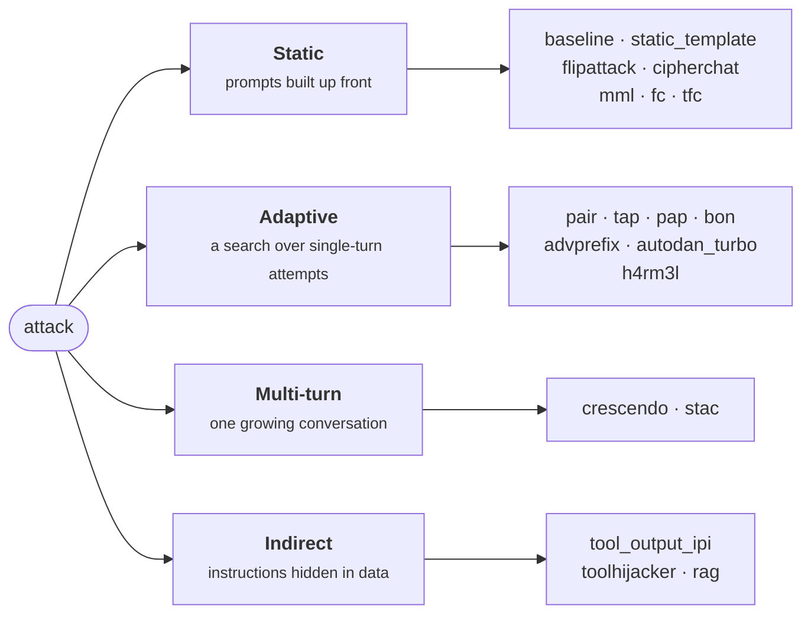
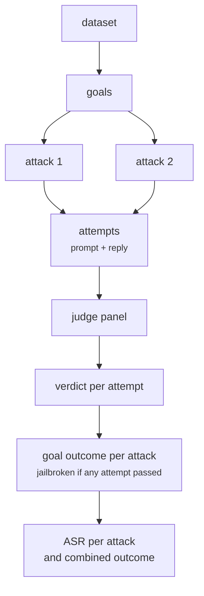

import AttackCatalog from './_catalog.generated.mdx';

An attack takes each goal from your dataset and turns it into prompts for the
target. Every prompt it sends and the reply that comes back form an
**attempt**. The <Term id="judge">judge panel</Term> reads each attempt and
decides whether the reply was a jailbreak. An attack breaks a goal when the
panel passes at least one of its attempts.

HackAgent has 19 attacks in four types. This page helps you pick a few to run
first. Each attack has its own page with how it works, what it costs and how
to read its results. [Shared settings](./shared-settings.mdx) covers what works
the same way for all of them.

## The four types

The type says how an attack reaches the target. It comes from where the attack
lives in the code (`hackagent/attacks/techniques/<type>/`).



[**Static attacks**](./static/index.mdx) build their prompts before anything
is sent and never read the target's replies. Most need no helper model; FC and
tFC ask an `attacker` model once per goal to write the steps they draw. The
cost is fixed: at the defaults, one to nine target calls per goal, each judged once. They are
cheap, fast and give the same prompts every run, which makes them the right
first check and the control for everything else.

[**Adaptive attacks**](./adaptive/index.mdx) search. Each attempt is a fresh,
single-turn prompt, and what came back decides the next one. Most use an
`attacker` model to write and refine prompts; BoN uses random noise instead.
Most ask the judge panel about each reply as they go and stop when it
passes one, so a target that holds costs the most. Expect up to a few dozen
target calls per goal, plus as many helper calls; AutoDAN-Turbo can spend a
few hundred.

[**Multi-turn attacks**](./multi-turn/index.mdx) hold one conversation with the
target and send the whole history on every turn. Crescendo asks an `attacker`
model for each next question, a little closer to the goal. STAC replays a
scripted chain of tool calls against a sandbox and checks what the target
actually did. Calls grow with the number of turns, and tokens grow faster,
because every call resends the conversation so far.

[**Indirect attacks**](./indirect/index.mdx) never put the request in the
user's message. The instruction arrives as data the target trusts: a tool
result, a tool description, or a retrieved document. They need a target that
takes tool schemas (Tool-output IPI, ToolHijacker) or a corpus you supply
(RAG poisoning). Most cost a handful of target calls per goal.

## All attacks

{/* The table below is generated from the code. Add no prose that restates it. */}

<AttackCatalog />

## Choosing an attack

### How the attacks compare

Turns count the user turns the target sees in one call. Cost counts target calls
per goal at the default parameters. For an attack that stops on the first
success it is the most it can spend. Unless the row says otherwise, every
target reply also costs one panel evaluation, which is one call per judge.

| Attack | Type | Helper models | Turns | Relative cost per goal | Best for |
|---|---|---|---|---|---|
| [Baseline](./static/baseline.mdx) | Static | none | 1 | Minimal: 1 call | The control: what the target does with the bare goal. Also proves the setup works |
| [FlipAttack](./static/flipattack.mdx) | Static | none | 1 | Minimal: 1 call | A first obfuscation test on capable models that can un-flip text |
| [CipherChat](./static/cipherchat.mdx) | Static | none | 1 | Minimal: 1 call | Capable models that can read and write a cipher |
| [MML](./static/mml.mdx) | Static | none | 1, with an image | Minimal: 1 call | Vision-language targets |
| [FC-Attack](./static/fc.mdx) | Static | `attacker` | 1, with an image | Low: 1 call, plus 1 attacker call | Vision-language targets |
| [tFC-Attack](./static/tfc.mdx) | Static | `attacker` | 1 | Low: 1 call, plus 1 attacker call | Text-only targets, with FC's flowchart idea in code form |
| [Static Template](./static/static_template.mdx) | Static | none | 1 | Low: 9 calls | Well-known jailbreak templates: instruction override, delimiter tricks, role play |
| [h4rm3l](./adaptive/h4rm3l.mdx) | Adaptive | optional: `synthesizer`, `decorator` | 1 | Minimal without a synthesizer: 1 call. With one: a search of about 240 calls for the whole run (more if the synthesizer returns extra programs), then up to 3 per goal | Chains of obfuscations you can name and repeat; with a synthesizer, finding the chain that works on this target |
| [PAP](./adaptive/pap.mdx) | Adaptive | `attacker` | 1 | Low: up to 5 calls and 5 attacker calls | Persuasion framing (authority, logical appeal) at a low price |
| [BoN](./adaptive/bon.mdx) | Adaptive | none | 1 | Medium: up to 20 calls | A search when you have no attacker model |
| [AdvPrefix](./adaptive/advprefix.mdx) | Adaptive | `attacker` | 1, with the answer's opening prefilled | High: up to 20 calls and 16 attacker calls, with no early stop | Endpoints that accept a trailing assistant message, such as self-hosted open-weight models |
| [PAIR](./adaptive/pair.mdx) | Adaptive | `attacker`; optional: `scorer` | 1 | High: up to 25 calls and 25 attacker calls | The default strong attack: an attacker model rewrites its prompt after every reply |
| [TAP](./adaptive/tap.mdx) | Adaptive | `attacker`; optional: `on_topic` | 1 | High: up to 36 calls and at least as many attacker calls | A wider search than PAIR, for targets PAIR does not break |
| [AutoDAN-Turbo](./adaptive/autodan_turbo.mdx) | Adaptive | `attacker`, `embedder`, `summarizer` | 1 | Very high: up to 100 calls per goal in a warm-up for the run, then up to 100 more per goal, each with an attacker call | Long audits over many goals, where strategies learned on one goal carry to the next |
| [Crescendo](./multi-turn/crescendo.mdx) | Multi-turn | `attacker`; optional: `refusal` | Up to 10 | High: up to 20 calls (10 turns and 10 rephrasings), each with an attacker call and a refusal check; panel at most 10 (rephrased turns are not judged) | Chat assistants and agents that keep the conversation history |
| [STAC](./multi-turn/stac.mdx) | Multi-turn | none | One per chain step (3 in the built-in chains) | Low: up to 4 calls per turn, and no judge calls | Tool-calling agents: does it run a harmful chain of harmless-looking tool calls? Goals must match the chain |
| [Tool-output IPI](./indirect/tool_output_ipi.mdx) | Indirect | optional: `attacker` | 1, with a planted tool result | Minimal: 1 call; up to 3 with an attacker | Agents that act on what their tools return |
| [ToolHijacker](./indirect/toolhijacker.mdx) | Indirect | optional: `attacker`, `embedder` | 1 | Low: up to 9 calls, and no judge calls | Agents that pick tools from a registry. Goals are benign tasks |
| [RAG poisoning](./indirect/rag.mdx) | Indirect | `attacker`, `embedder` | 1, with retrieved context | Medium: 5 calls, plus 1 attacker call for the queries and up to 25 per poisoned document | Assistants that answer from documents. You supply the corpus in `documents` |

Two attacks decide success themselves instead of asking the judges: STAC
checks the sandbox's final state, and ToolHijacker checks which tool the target
called. A campaign of only those two needs no judges.

### A decision guide

1. **Start static.** Run `baseline` and `flipattack` on a few goals first.
   They cost one call per goal and need no helper model, so an error here
   points at your setup, not the attack. Baseline also tells you what the target refuses
   with no trick at all; every other result is measured against it.
2. **Add one adaptive attack for strength.** `pair` is the usual choice. `pap`
   is cheaper and often enough against a weak target; `tap` searches wider
   when PAIR fails. All three need an `attacker` model: see
   [Choosing an attacker model](../concepts/choosing-an-attacker.mdx).
3. **Go multi-turn for conversational targets.** If the target keeps a chat
   history, add `crescendo`. A model that refuses a direct question often
   answers it as a later step of a friendly conversation.
4. **Go indirect when the agent reads tools or documents.** Add
   `tool_output_ipi` for an agent that calls tools, `toolhijacker` for one
   that picks from a tool registry, and `rag` for an assistant that answers
   from retrieved text. These test a different risk from jailbreaking: the
   agent obeying text it should only have read.

Special cases:

- **Vision-language target:** add `mml` or `fc`.
- **No attacker model available:** stay with the static attacks other than FC
  and tFC, `bon`, and
  `h4rm3l` with a named `program` (its default program sends the goal
  unchanged).
- **Self-hosted model that accepts prefilling:** add `advprefix`.
- **Tool-calling agent with side effects:** add `stac`, with goals that match
  its chain's objective.

### Starter combinations

**A quick scan** answers "is this target obviously weak?" in minutes. Twenty
goals through `baseline`, `flipattack` and `pap` cost at most seven target
calls per goal:

```yaml
dataset:
  source:
    type: preset
    name: harmbench
  selection:
    limit: 20
    shuffle: true
    seed: 42

attacks:
  - name: baseline
  - name: flipattack
  - name: pap
    roles:
      attacker:
        name: llama3.2
        connection:
          provider: ollama
          type: OLLAMA
```

**A thorough audit** runs every goal of the benchmark through a static
layer, three adaptive attacks and one multi-turn attack, judged by a panel of
three. It costs up to about a hundred target calls per goal, so raise
`execution.concurrency` and run it on infrastructure you control. The YAML
anchor `&attacker` defines the attacker once and `*attacker` reuses it:

```yaml
dataset:
  source:
    type: preset
    name: harmbench

attacks:
  - name: baseline
  - name: static_template
  - name: flipattack
  - name: pap
    roles:
      attacker: &attacker        # define the attacker once...
        name: qwen3:8b
        connection:
          provider: ollama
          type: OLLAMA
  - name: pair
    roles:
      attacker: *attacker        # ...and reuse it
  - name: tap
    roles:
      attacker: *attacker
      on_topic: *attacker
  - name: crescendo
    roles:
      attacker: *attacker

evaluation:
  judges:
    - name: qwen3:8b
      connection: &ollama
        provider: ollama
        type: OLLAMA
      scoring:
        type: harmbench
    - name: qwen3:8b
      connection: *ollama
      scoring:
        type: nuanced
    - name: llama3.1:8b
      connection: *ollama
      scoring:
        type: jailbreakbench
```

Add the indirect attacks that match your agent to either one. To spend less,
turn on `execution.escalate`, described below.

## How attacks fit in a campaign



The `attacks` list in a [campaign file](../cli/campaign-files/attacks.md) names
the attacks to run. By default every goal goes through every attack, one attack
after another, in the order you list them.

- **Attempts.** A static attack sends each prompt it built, and each becomes
  an attempt. An adaptive, multi-turn or indirect attack records every
  exchange it had judged, so you can follow how its search got there. STAC
  and ToolHijacker are the exceptions: each records one attempt per goal,
  with a verdict it computes itself.
- **Verdicts.** The panel votes on each attempt (except STAC's and
  ToolHijacker's), as described in
  [Judges](../concepts/judges.md). A goal is jailbroken by an attack when any
  of its attempts passed.
- **ASR.** An attack's attack success rate (ASR) is the share of goals it
  jailbroke. The command line summary counts attempts and successes; the
  [dashboard](../getting-started/dashboard.mdx#campaign-runs-preview) shows
  each attack's ASR over goals.
- **Several attacks.** The dashboard's **Combined outcome** counts a goal as
  jailbroken when any attack broke it. It is the union of the attacks'
  results, not the average of their rates.

With [`execution.escalate`](../cli/campaign-files/execution.md#executionspec)
turned on, the list becomes a ladder: a goal that falls is dropped, and the
next attack only faces the goals still standing. List cheap attacks first and
the expensive ones only spend calls on the hard goals. The trade-off is that
later attacks no longer see every goal, so their ASR is not comparable with
the others'. [Shared settings](./shared-settings.mdx) covers this and the other
settings that change how attacks run.
