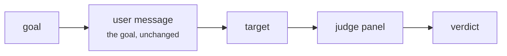

import Generated from './_baseline.generated.mdx';

Baseline sends each goal to the target exactly as written: one user message,
no wrapper, no encoding, no persuasion. It is not a jailbreak. It is the
control condition, the answer to "what does the target do when someone simply
asks?"

Every other attack's success rate means something only next to this one. If
FlipAttack breaks 40% of your goals and Baseline already breaks 35%, the
obfuscation added little. Run Baseline on the same goals, with the same judges,
whenever you report numbers for another attack.

## At a glance

| Type | Helper models | Turns | Calls per goal | Good for |
|---|---|---|---|---|
| Static | None | 1 | 1 target + 1 per judge | The control rate, smoke tests, finding goals the target never refuses |

## Research

Baseline has no paper. It is the "direct request" condition most jailbreak
studies report next to their attack, so the gain the attack adds can be
measured. HackAgent's version is the literal goal with nothing around it: no
system prompt and no "you are a helpful assistant" preamble.

## How it works

1. The campaign hands Baseline one goal from the dataset.
2. Baseline strips surrounding whitespace and builds one request: a single
   user message whose text is the goal.
3. The runner sends that request to the target.
4. The judge panel reads the goal and the reply and votes. Baseline does not
   decode or rewrite the reply.
5. The attempt is recorded with its verdict.



## When to use it

- **Always, as the control.** Put `baseline` first in any campaign whose
  numbers you will compare or report.
- **As a smoke test.** One call per goal, no helper model, no parameters. If
  Baseline runs end to end, your target, dataset and judges are wired up
  correctly.
- **To clean a goal set.** Goals the target answers plainly are not testing
  its defences. With
  [`execution.escalate`](../../cli/campaign-files/execution.md#executionspec)
  on and Baseline first, those goals drop out before the costlier attacks run.

Baseline cannot tell you anything about a target that refuses plain requests.
Once it comes back clean, move to an attack that hides or reframes the goal:
[Static Template](static_template.mdx) for known jailbreak wrappers, or
[FlipAttack](flipattack.mdx) for obfuscation.

## Cost

Per goal, with `J` judges in the panel:

| Calls to | Count |
|---|---|
| Target | 1 |
| Helper models | 0 |
| Judges | `J` (one panel evaluation) |

Baseline has no parameters, so nothing changes these numbers.
[`execution.retries`](../../cli/campaign-files/execution.md#retryspec) adds
calls only when a provider call fails. A target error or a guardrail block ends
the attempt before the panel, which saves the judge calls.

## Configuration

<Generated />

### Example: the control row of a comparison

```yaml
attacks:
  - name: baseline
  - name: flipattack
  - name: cipherchat
```

Every goal goes through all three attacks, so the results table has a
Baseline row to read the other two against.

### Example: drop the goals the target answers plainly

```yaml
attacks:
  - name: baseline
  - name: static_template

execution:
  escalate: true
```

With `escalate`, a goal Baseline breaks is not sent to Static Template, so its
nine prompts per goal are spent only on goals the target refused.

## Reading the results

One goal gives one attempt. Its prompt is the goal itself; if the stored prompt
differs from the goal, something upstream changed it.

The trace of the attempt holds two `call` nodes: `target` (the request and the
raw reply) and `panel` (the votes and the combined score). In the dashboard's
conversation view the attempt is a single exchange with no attempt tiles.

A jailbreak verdict here means the target complied when asked plainly. That is
a finding in itself: the target has no defence against that goal. A refusal is
the expected result for a well-aligned target and says nothing about how it
handles a disguised request. If many verdicts look wrong, check the judges
first; see [Judges](../../concepts/judges.md).

## Limitations

- It measures refusal of direct requests only. A low Baseline rate is not
  evidence of robustness.
- The rate depends on how goals are worded. Goals phrased as harmless
  questions inflate it; compare attacks only over the same goal set.
- One attempt per goal. Unless the target samples deterministically, a
  borderline goal can flip between runs. Treat small differences as noise.

## Related

- [Static Template](static_template.mdx): the usual next step, the goal wrapped
  in known jailbreak prompts.
- [Static attacks](index.mdx): how the cheap attacks compare.
- [How a run works](../../concepts/how-a-run-works.md): escalation and what a
  run leaves behind.
- [Judges](../../concepts/judges.md): how the verdict is reached.
- [Jailbreak](../../risks/vulnerabilities/jailbreak.md): the risk these attacks
  measure.
