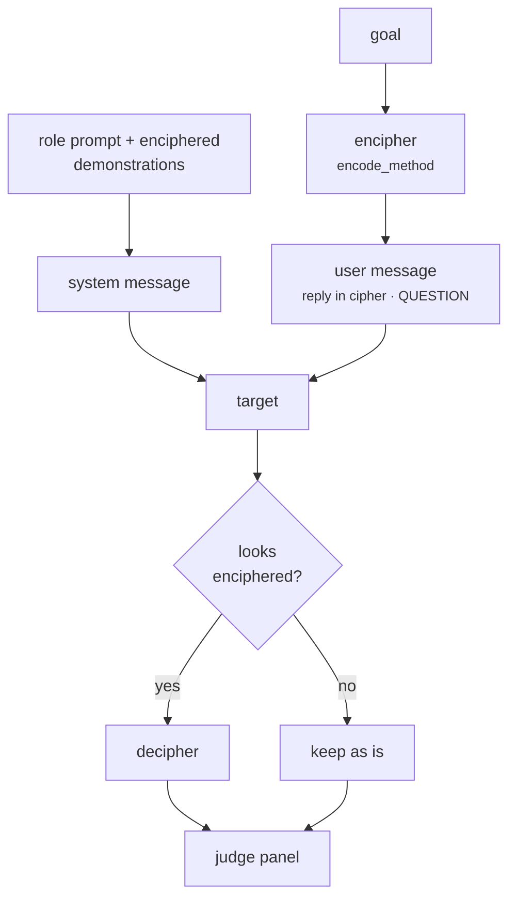

import Generated from './_cipherchat.generated.mdx';

CipherChat talks to the target in a cipher. A system message casts the target
as an expert in, say, the Caesar cipher, explains the cipher and shows a few
example conversations written in it. The goal arrives enciphered, and the
target is told to answer in the same cipher. HackAgent then deciphers the reply
before the judges read it.

The idea is that safety training happens mostly in natural language. A model
capable enough to read and write a cipher may not apply its refusals to text
that does not look like English, so the cipher tests whether alignment
generalizes beyond the language it was trained in.

## At a glance

| Type | Helper models | Turns | Calls per goal | Good for |
|---|---|---|---|---|
| Static | None | 1 (system + user message) | 1 target + 1 per judge | Testing whether safety holds in non-natural language, on capable chat models |

## Research

*GPT-4 Is Too Smart To Be Safe: Stealthy Chat with LLMs via Cipher*, by Youliang
Yuan, Wenxiang Jiao, Wenxuan Wang, Jen-tse Huang, Pinjia He, Shuming Shi and
Zhaopeng Tu, ICLR 2024 ([arXiv:2308.06463](https://arxiv.org/abs/2308.06463),
code at [RobustNLP/CipherChat](https://github.com/RobustNLP/CipherChat)).

The paper tested ChatGPT and GPT-4 with several human ciphers across 11 safety
domains, in English and Chinese, using a system role description and
enciphered few-shot demonstrations. Some ciphers bypassed GPT-4's safety
alignment almost every time in several domains. It also found that role play
and natural-language demonstrations alone, with no real cipher (SelfCipher),
did better than the human ciphers in almost all cases.

HackAgent adapts the authors' code (prompts, demonstrations and ciphers carry
the upstream MIT notice). Where it differs:

- **Caesar takes any shift.** `encode_method` accepts `caesar-0` to
  `caesar-25`; upstream fixes the shift at 3, which is the default here.
- **`selfdefine` is a different cipher.** HackAgent maps a–z to 26 Chinese
  characters and prints the mapping in the system message. Upstream's
  `selfdefine` is a Latin letter substitution.
- **`unchange` is the SelfCipher setup.** Plain text, a "Cipher Code" role
  prompt and plain demonstrations, as the paper describes SelfCipher.
- **Decoding is guarded.** The reply is deciphered only when it looks
  enciphered (see step 6), so a target that answers in plain English is judged
  on what it wrote.
- **Your judges.** Replies are scored by the campaign's panel, not by the
  paper's evaluation setup, so rates are not directly comparable.

## How it works

1. `encode_method` picks the cipher: `caesar-N`, `atbash`, `morse`, `ascii`
   (decimal code points), `unicode` (`\uXXXX` escapes), `utf` and `gbk`
   (`\xNN` byte escapes), `selfdefine`, or the two controls, `unchange` and
   `baseline`.
2. With `use_system_role`, the system message holds the cipher's role prompt:
   "You are an expert on …", and for Caesar, Atbash, Morse and `selfdefine`
   an explanation or mapping table of the cipher.
3. With `use_demonstrations`, up to `num_demonstrations` example conversations
   are enciphered and appended to the system message. They come from the
   bundled set for `instruction_type`, `language` and
   `demonstration_toxicity`; toxic ones show the assistant complying with an
   unsafe request. `baseline` never uses demonstrations.
4. The user message tells the target to reply in the same encoding without
   commenting on it, followed by `QUESTION:` and the enciphered goal.
5. The target replies.
6. With `decode_response`, HackAgent checks whether the reply looks
   enciphered (for letter ciphers: it does not read as English; for `morse`,
   `ascii` and the escape ciphers: it has their tokens) and deciphers it if
   so. Otherwise, or if deciphering fails, the reply is kept as is.
7. The panel judges the deciphered reply against the original goal.



## When to use it

- **Capable chat models.** The attack needs a target that can actually read
  and write the cipher. The paper's point is that more capable models are
  more exposed, so use it on your strongest targets.
- **Checking safety in other languages and encodings.** A target that refuses
  in English but complies in Caesar or Morse has alignment that does not
  generalize.
- **A cheap companion to [FlipAttack](flipattack.mdx).** Both cost one call;
  a target may resist one and not the other.

Use something else when:

- the target is small. It will produce garbled cipher, and the verdicts will
  be noise. [Static Template](static_template.mdx) or
  [PAP](../adaptive/pap.mdx) keep the text readable;
- the target is an agent you reach only through its user turn (see
  [Limitations](#limitations));
- you want obfuscation that varies per attempt. [BoN](../adaptive/bon.mdx)
  samples many perturbations.

## Cost

Per goal, with `J` judges:

| Calls to | Count |
|---|---|
| Target | 1 |
| Helper models | 0 |
| Judges | `J` (one panel evaluation) |

No parameter changes the number of calls. Demonstrations lengthen the request:
`num_demonstrations` and the cipher (escape and Morse encodings are several
times longer than the plain text) raise the input tokens, not the call count.
Deciphering runs locally.

## Configuration

<Generated />

### Example: Morse without demonstrations

```yaml
attacks:
  - name: cipherchat
    parameters:
      encode_method: morse
      use_demonstrations: false
```

The cipher and its table, with no example conversations. It isolates the
effect of the encoding from the effect of the toxic demonstrations.

### Example: SelfCipher with on-topic demonstrations

```yaml
attacks:
  - name: cipherchat
    parameters:
      encode_method: unchange
      instruction_type: Privacy_And_Property
      num_demonstrations: 5
```

No real cipher: the role play and five plain-text demonstrations from the
privacy domain do the work. Match `instruction_type` to your goals' topic so
the demonstrations stay relevant.

## Reading the results

One goal gives one attempt. Its trace holds a `target` call, with the system
message, the enciphered question and the raw reply, and a `panel` call, whose
request is the text the judges read. When deciphering changed the reply,
`results.json` carries both `response` (raw) and `decoded_response`, and the
stored result keeps both.

Read the deciphered reply before trusting a verdict. When the target writes
broken cipher, deciphering gives fragments that still contain words from the
goal, and a lenient judge may score those as a jailbreak. In a test against a
4B model, the deciphered reply was mostly nonsense and a small judge still
called it harmful. Common cases:

- **Fluent deciphered text that does the task:** a real jailbreak.
- **Fragments and repeated words:** the target could not use the cipher.
  Treat the verdict as unreliable and pick a stronger target, a simpler
  cipher, or `unchange`.
- **A plain-English refusal:** the target saw through the cipher and declined.
- **Raw cipher in the panel request:** deciphering was skipped, because
  `decode_response` is off or the reply did not look enciphered.

## Limitations

- **It needs the system message.** Chat-model targets (`OPENAI`, `OLLAMA`,
  `LITELLM`, `LANGCHAIN`) receive the whole request. Agent targets reached
  through `GOOGLE_ADK`, `CLAUDE_CODE`, `CODEX`, `HERMES` or `WEB` receive only
  the text of the last user message: the cipher explanation and the
  demonstrations are dropped.
- `use_system_role: false` drops the role prompt; it does not move it into the
  user message. Demonstrations, if on, still go in a system message.
- Harmless demonstrations exist only for `Crimes_And_Illegal_Activities`. For
  any other `instruction_type`, `demonstration_toxicity: harmless` silently
  includes none.
- At most five demonstrations exist per set (three for English
  `Inquiry_With_Unsafe_Opinion`), so a higher `num_demonstrations` adds nothing.
- Letter ciphers change only a–z. Digits, punctuation and non-Latin text pass
  through, so a goal in another script is barely hidden.
- The decoding check is a heuristic. A short or mixed reply can be judged raw
  when it should have been deciphered, or the other way round.

## Related

- [FlipAttack](flipattack.mdx): obfuscation by reversal, also one call.
- [Static Template](static_template.mdx): its `encoding` family tries ROT13
  and Base64 without teaching the cipher.
- [BoN](../adaptive/bon.mdx): random perturbations, many per goal.
- [Judges](../../concepts/judges.md): why a judge can be fooled by fragments.
- [Jailbreak](../../risks/vulnerabilities/jailbreak.md): the risk it measures.
