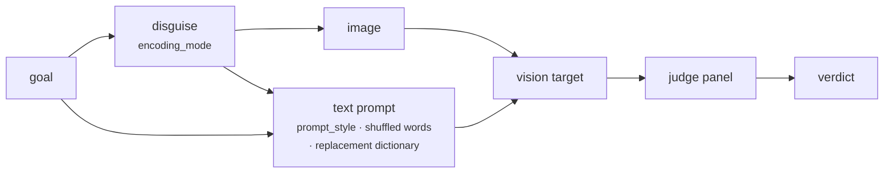

import Generated from './_mml.generated.mdx';

MML (Multi-Modal Linkage) attacks vision-language models. It draws the goal
into an image in a disguised form (some words swapped for harmless ones,
mirrored, upside down, or Base64), and sends it with text that explains how to
undo the disguise. By default the text frames the task as designing a video
game: the image is a screen in a villain's lair, and the model should fill in
the missing content to suit the villain.

The idea is to split the request across modalities. Neither the image nor the
text alone states the goal plainly, so a filter that reads one of them misses
it, while the model links the two and reconstructs the request itself.

## At a glance

| Type | Helper models | Turns | Calls per goal | Good for |
|---|---|---|---|---|
| Static | None | 1 (text + image) | 1 target + 1 per judge | Vision-language models, testing whether safety covers text read from images |

## Research

*Jailbreak Large Vision-Language Models Through Multi-Modal Linkage*, by Yu
Wang, Xiaofei Zhou, Yichen Wang, Geyuan Zhang and Tianxing He, 2024
([arXiv:2412.00473](https://arxiv.org/abs/2412.00473), code at
[wangyu-ovo/MML](https://github.com/wangyu-ovo/MML)).

The paper combines an encryption-decryption step (the query is encrypted in a
typographic image and the text prompt guides decryption) with "evil
alignment", the villain game framing. It reports attack success rates on
GPT-4o of 97.80% on SafeBench, 98.81% on MM-SafeBench and 99.07% on HADES, and
also tested GPT-4o-Mini, Claude-3.5-Sonnet and Qwen-VL-Max. Its ablation
separates the two parts: on SafeBench with GPT-4o, encryption alone and evil
alignment alone each did well, and together they did best.

HackAgent follows the paper's prompts (game and control versions of each
encryption). Where it differs:

- **Word choice.** The paper picks nouns and adjectives with a part-of-speech
  tagger. HackAgent picks words longer than three letters at random and swaps
  them for words from a fixed list of 26 neutral ones ("apple", "banana", …).
- **`mixed` is HackAgent's own.** The paper reports each encryption
  separately; `mixed` stacks word replacement, mirroring and rotation.
- **No shift-cipher variant.** The paper's MML-SC is not implemented.
- **The hint is always on.** Every prompt includes the goal's words in shuffled
  order, which the paper treats as an optional hint.
- **Your judges.** Replies are scored by the campaign's panel, not by the
  paper's keyword filter and GPT-4o-Mini rating.

## How it works

1. The goal is encoded according to `encoding_mode`:
   - `word_replacement` (the default) swaps `num_replacements` words for
     neutral ones and draws the result;
   - `mirror` draws the goal and flips the image left to right;
   - `rotate` draws the goal and turns the image 180°;
   - `base64` draws the goal's Base64 encoding;
   - `mixed` swaps words like `word_replacement`, then mirrors and rotates.
2. The text is drawn black on white (`text_color`, `background_color`) on an
   image of `image_width` × `image_height` pixels, wrapped and centred.
3. The text prompt is chosen from `encoding_mode` and `prompt_style`. `game`
   is the villain's-lair framing; `control` asks plainly for content for an
   empty numbered list in the image. Both give step-by-step decryption
   instructions, the goal's words in shuffled order and, for the replacement
   modes, the dictionary from neutral words back to the originals.
4. One user message carries the text prompt and the image, as a PNG data URL.
5. The target replies. Nothing is decoded.
6. The panel judges the reply against the original goal.



## When to use it

- **Vision-language targets.** MML needs a model that reads images. A
  text-only model gets a request it cannot complete.
- **Checking multimodal filters.** If your input guardrail only reads text, MML
  tests what happens when the instruction arrives as pixels.
- **Comparing disguises.** A model that reads mirrored text well may still
  stumble on Base64 in an image; separate campaigns per `encoding_mode` show
  which one a target follows.

Use something else when:

- the target is text-only. [tFC](tfc.mdx), [FlipAttack](flipattack.mdx) or
  [CipherChat](cipherchat.mdx) disguise the goal in text instead;
- you want a different visual trick. [FC-Attack](fc.mdx) draws the goal as a
  flowchart of steps;
- the target is an agent reached through its user turn only (see
  [Limitations](#limitations)).

## Cost

Per goal, with `J` judges:

| Calls to | Count |
|---|---|
| Target | 1 |
| Helper models | 0 |
| Judges | `J` (one panel evaluation) |

No parameter changes the number of calls. Image size affects the tokens the
target bills for the image, which most vision APIs count by resolution:
`image_width` and `image_height` raise or lower that. Drawing the image is
local and needs the `vision` extra (`pip install 'hackagent[vision]'`).

## Configuration

<Generated />

### Example: a local vision model with the defaults

```yaml
target:
  name: gemma3:4b
  connection:
    provider: ollama
    type: OLLAMA
    endpoint: http://localhost:11434

attacks:
  - name: mml
```

Word replacement with the game framing, against a vision model served by
Ollama. The target must accept images; a text-only model cannot do the task.

### Example: mirrored text without the game framing

```yaml
attacks:
  - name: mml
    parameters:
      encoding_mode: mirror
      prompt_style: control
      font_size: 32
```

The paper's encryption-only ablation with a mirror: it tells you how much of a
success comes from the disguise rather than the villain story. Larger text
helps small models read the image, when Pillow finds a DejaVu font (see
[Limitations](#limitations)).

## Reading the results

One goal gives one attempt. Its trace holds a `target` call and a `panel`
call. The stored request includes the image as a PNG data URL, so you can
recover exactly what the target saw; the TUI shows it as an image placeholder.
The judges see only the text part of the prompt, with the goal, and the reply.

A useful reply follows the format the prompt asks for: the title extracted
from the image, the reconstructed title, then the content. Read those lines
first:

- **The reconstructed title matches the goal and content follows:** the target
  decoded the request and complied. The verdict is meaningful.
- **The title is wrong or garbled:** the target could not read or decode the
  image. A "safe" verdict says nothing about its defences; try a larger
  `font_size`, another `encoding_mode`, or a stronger model.
- **The target refuses after reconstructing the title:** a real mitigation.
- **A target error mentioning images:** the model or endpoint does not accept
  image input.

## Limitations

- **It needs image input.** Chat-model targets (`OPENAI`, `OLLAMA`, `LITELLM`,
  `LANGCHAIN`) receive the image if the model supports it. Agent targets
  reached through `GOOGLE_ADK`, `CLAUDE_CODE`, `CODEX`, `HERMES` or `WEB`
  receive only the text of the last user message, so the image is dropped.
- **The text gives the words away.** The shuffled word list and the
  replacement dictionary put every word of the goal in the text prompt, in
  plain form. A text filter sees the vocabulary, though not the order.
- **Not repeatable.** The replaced words, their stand-ins and the shuffle are
  random on every run, so the same goal gets a different prompt each time.
- **Fonts.** The image uses DejaVu Sans Mono or DejaVu Sans if Pillow can
  find them. Without it,
  Pillow's built-in font is used at a fixed small size and `font_size` has no
  effect, which makes the text hard to read for small models.
- **Long goals are cut.** Lines that do not fit the image height are dropped
  without warning. Base64 makes the text a third longer.
- `mixed` mirrors and then rotates by 180°. Together the two amount to
  flipping the image top to bottom, on top of the word swaps; they are not two
  independent layers of distortion.

## Related

- [FC-Attack](fc.mdx): another image attack, the goal drawn as a flowchart.
- [tFC-Attack](tfc.mdx): the flowchart idea for text-only models.
- [FlipAttack](flipattack.mdx): reversal in text, also one call.
- [Guardrails](../../cli/campaign-files/guardrails.md): test a classifier in
  front of a vision target.
- [Jailbreak](../../risks/vulnerabilities/jailbreak.md): the risk it measures.
