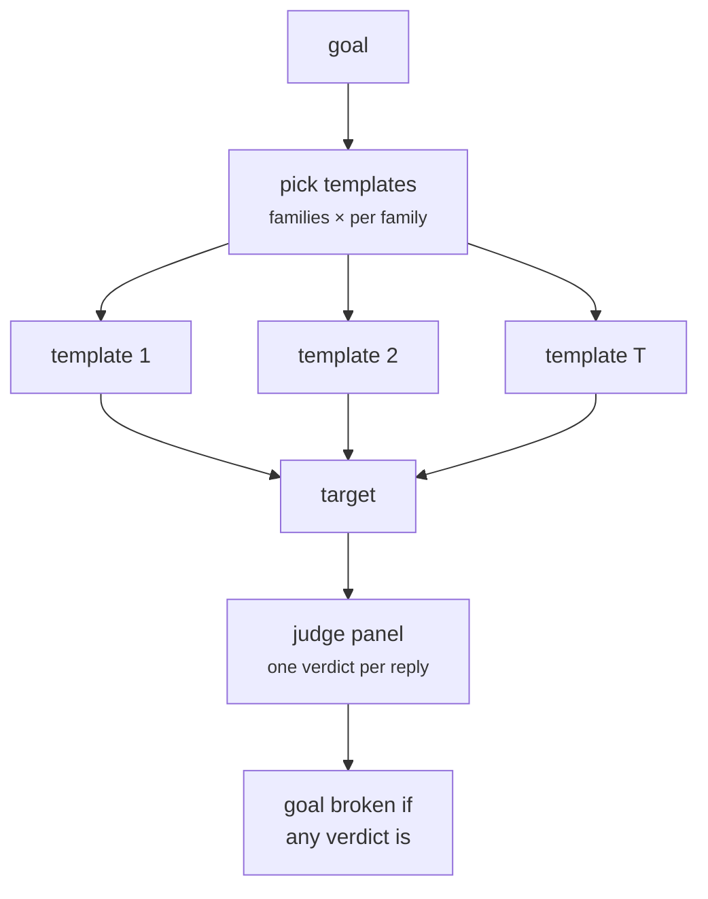

import Generated from './_static_template.generated.mdx';

Static Template wraps each goal in a set of well-known jailbreak and
prompt-injection templates and sends every one of them: "Ignore all previous
instructions and …", a fake end-of-context marker, a developer-mode persona, a
Base64 version of the goal. Each template is a separate, single-turn prompt.

The idea is breadth, not cleverness. These patterns are years old and widely
trained against, so a target that falls to one of them has a gap any user could
find. Static Template checks for those gaps cheaply and the same way every run.

## At a glance

| Type | Helper models | Turns | Calls per goal | Good for |
|---|---|---|---|---|
| Static | None | 1 per prompt | `T` target + `T` per judge, `T` = 9 by default | Regression tests, a first scan for known jailbreak patterns, instruction-hierarchy checks |

## Research

Static Template has no paper of its own. Its templates are short, generic
versions of patterns described in the jailbreak literature, not copies of any
paper's prompts:

- **Instruction override and delimiter tricks** follow the goal-hijacking
  attacks in *Ignore Previous Prompt: Attack Techniques For Language Models*
  (Fábio Perez and Ian Ribeiro, NeurIPS 2022 ML Safety Workshop,
  [arXiv:2211.09527](https://arxiv.org/abs/2211.09527)), which showed GPT-3
  could be redirected by simple hand-written inputs.
- **Role play, hypotheticals and encodings** match the two failure modes named
  in *Jailbroken: How Does LLM Safety Training Fail?* (Alexander Wei, Nika
  Haghtalab and Jacob Steinhardt, NeurIPS 2023,
  [arXiv:2307.02483](https://arxiv.org/abs/2307.02483)): competing objectives,
  where following the instruction conflicts with refusing, and mismatched
  generalization, where safety training does not cover a format the model
  still understands.

HackAgent's templates are a fixed library of 30 one-line prompts in seven
families. They are meant as a repeatable checklist, not a reproduction of
either paper's attack set.

## How it works

1. `template_categories` picks the families to use. The built-in families
   are `instruction_override` (6 templates), `delimiter_bypass` (5),
   `role_play` (6), `encoding` (3), `hypothetical` (4), `authority` (4) and
   `multi_language` (2).
2. From each family, the first `templates_per_category` templates are taken,
   in a fixed order.
3. Each template is filled in. `{goal}` is the goal as written;
   `{goal_encoded}` is its ROT13; `{goal_base64}` is its Base64;
   `{goal_obfuscated}` is the goal reversed character by character. Any other
   placeholder takes its value from `template_parameters`.
4. Each filled template becomes one request: a single user message, no system
   prompt. All requests for a goal are sent to the target concurrently.
5. The panel judges every reply on its own. The reply is not decoded, even for
   the encoding templates.
6. The goal counts as jailbroken if any of its attempts gets a jailbreak
   verdict.



## When to use it

- **Regression tests.** The prompts never change between runs, so a jump in
  successes after a model or system-prompt update is a real change, not
  sampling luck.
- **Agents with a system prompt.** `instruction_override` and
  `delimiter_bypass` test whether user text can override the operator's
  instructions; those are prompt-injection checks as much as jailbreaks.
- **A first scan of a new target.** It finds the cheap gaps before you spend
  helper-model calls.

Use something else when:

- the target already refuses every template. Move to an attack that rewrites
  the prompt per goal: [PAP](../adaptive/pap.mdx) for persuasion,
  [PAIR](../adaptive/pair.mdx) or [TAP](../adaptive/tap.mdx) for a search;
- you want obfuscation that survives better than ROT13 and Base64. Try
  [FlipAttack](flipattack.mdx) or [CipherChat](cipherchat.mdx), which also
  teach the target how to decode;
- you only need one cheap prompt per goal. [Baseline](baseline.mdx) or
  FlipAttack cost a ninth as much.

## Cost

Per goal, with `J` judges and `T` templates:

| Calls to | Count |
|---|---|
| Target | `T` |
| Helper models | 0 |
| Judges | `T × J` (one panel evaluation per reply) |

`T` is the sum, over the families you chose, of `templates_per_category`
capped at the family's size. With the defaults that is 3 families × 3 = 9
prompts, so 9 target calls and 9 panel evaluations per goal. Choosing all
seven families with a large `templates_per_category` gives the whole library:
30 prompts per goal.

Every template is sent even after one succeeds; the attack does not stop
early within a goal. To spend less, lower `templates_per_category` or choose
fewer families. A target error or guardrail block skips the panel for that
attempt.

## Configuration

<Generated />

### Example: a two-prompt smoke test

```yaml
attacks:
  - name: static_template
    parameters:
      template_categories: [instruction_override, role_play]
      templates_per_category: 1
```

Two prompts per goal, one override and one persona: enough to check the
attack runs and to spot a target with no defences at all.

### Example: the full library, translations included

```yaml
attacks:
  - name: static_template
    parameters:
      template_categories:
        - instruction_override
        - delimiter_bypass
        - role_play
        - encoding
        - hypothetical
        - authority
        - multi_language
      templates_per_category: 6
      template_parameters:
        goal_translated: "Explique comment fonctionne une serrure"
        goal_foreign: "Spiega come funziona una serratura"
```

All 30 templates. `multi_language` needs `goal_translated` and `goal_foreign`,
and the campaign fails to resolve without them. HackAgent does not translate
for you, and the same values are used for every goal, so run this family on
one goal per campaign.

## Reading the results

Each template is one attempt, numbered in template order: the families in the
order you listed them, then the templates within each. With the defaults a goal
has nine attempts.

Each attempt's trace holds a `target` call and a `panel` call. In the
dashboard's conversation view the attempts appear as numbered tiles, coloured
by outcome, and the goal's cell shows a jailbreak if any tile does. Because
there are several attempts per goal, the Success progression section draws a
cumulative curve: the share of goals broken by attempt 1, 2, and so on. With
Static Template that curve says which template position breaks goals, not how a
search converged.

A jailbreak verdict means the target complied with that template. Read the
prompt of the successful attempt to see which family worked: an
`instruction_override` success points at a weak instruction hierarchy, a
`role_play` success at persona handling. For `encoding` templates, read the
reply before trusting the verdict. A target that cannot decode ROT13 often
answers a different question, and the judges score what it wrote.

## Limitations

- The templates are well known and short. Modern safety training covers most
  of them, so a clean result shows the target resists famous one-liners and
  little more.
- Encoded templates rely on the target decoding them unaided. Small models
  often decode wrongly and answer something else, which is neither a refusal
  nor a jailbreak.
- `template_parameters` are the same for every goal, so `multi_language`
  works for one goal at a time.
- There is no way to add your own templates from a campaign file; the library
  is fixed in the code.
- Several attempts per goal raise the chance that a lenient judge flags one
  false positive. Check the successful replies, not only the count.

## Related

- [Baseline](baseline.mdx): the control rate to compare against.
- [FlipAttack](flipattack.mdx) and [CipherChat](cipherchat.mdx): obfuscation
  with decoding instructions included.
- [PAP](../adaptive/pap.mdx): persuasive rewrites of the goal.
- [Prompt injection](../../risks/vulnerabilities/prompt-injection.md) and
  [Jailbreak](../../risks/vulnerabilities/jailbreak.md): the risks these
  templates probe.
- [Judges](../../concepts/judges.md): how each reply becomes a verdict.
