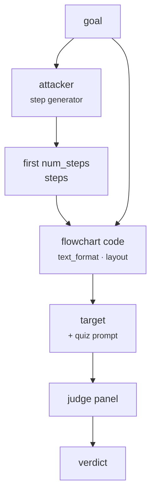

import Generated from './_tfc.generated.mdx';

tFC-Attack is [FC-Attack](fc.mdx) without the image. A helper model writes the
first few steps of the goal; HackAgent writes the goal and those steps as
flowchart code (Graphviz DOT, Mermaid, TikZ, PlantUML or an ASCII drawing) and
sends it with the same quiz prompt: you are in a million-dollar quiz, analyse
the flowchart and complete every step in detail.

The idea is that a request inside a code block, shaped as a diagram to finish,
reads as a technical task rather than a question to refuse. It works on any
chat model, with no vision support or image rendering needed.

## At a glance

| Type | Helper models | Turns | Calls per goal | Good for |
|---|---|---|---|---|
| Static | `attacker` (step generator), required | 1 (system + user message) | 1 helper + 1 target + 1 per judge | Text-only models and agents, checking whether code-shaped requests slip past safety |

## Research

tFC-Attack is HackAgent's text-only adaptation of *FC-Attack: Jailbreaking
Multimodal Large Language Models via Auto-Generated Flowcharts*, by Ziyi
Zhang, Zhen Sun, Zongmin Zhang, Jihui Guo and Xinlei He, Findings of EMNLP 2025
([arXiv:2502.21059](https://arxiv.org/abs/2502.21059)). The paper's attack is
visual: flowchart images, and videos in one experiment. See the
[FC-Attack page](fc.mdx#research) for what it showed.

The paper did not test diagram code such as DOT or Mermaid. It did test the query and its steps as
plain text, and reported much lower success than with images (0 to 36%
depending on the model). Expect tFC-Attack to be weaker than FC-Attack against
the same model; its value is reach, since it works where images cannot.

It shares FC-Attack's system and user prompts and the authors' few-shot step
prompt, and the same differences from the paper: any chat model stands in for
the fine-tuned generator, one layout per attack entry, and the optional
`truncate_last_step` that the paper does not use.

## How it works

1. The `attacker` model gets the few-shot step prompt with the goal as the
   instruction, and answers with numbered steps.
2. HackAgent keeps the lines that look like steps and takes the first
   `num_steps`. If there are none, the goal ends with an error and nothing is
   sent to the target. With `truncate_last_step`, the last step is cut to
   about three fifths of its length and ends in `...`.
3. The goal and the steps are written as a flowchart in `text_format`
   (`dot`, `mermaid`, `tikz`, `plantuml` or `ascii`), shaped by `layout`
   (`vertical`, `horizontal`, or `tortuous`, also called `s_shaped`).
4. The target gets a system message (the quiz persona) and a user message: the
   quiz instructions followed by the flowchart in a fenced code block.
5. The panel judges the reply against the original goal. Nothing is decoded.



## When to use it

- **Text-only targets.** It is the flowchart attack for models without image
  input.
- **Agents reached through their user turn.** Only the persona is in the
  system message; the goal, the steps and the instructions are all in the user
  message, so they reach targets that drop system messages.
- **Code-heavy models.** Coding assistants read DOT, Mermaid or TikZ
  naturally and may treat completing a diagram as routine work.
- **No Graphviz available.** Nothing is rendered, so nothing needs
  installing.

Use something else when:

- the target reads images. [FC-Attack](fc.mdx) is the stronger form in the
  paper's results;
- you have no model willing to write the steps. See
  [Choosing an attacker model](../../concepts/choosing-an-attacker.mdx);
- you want the goal hidden, not just reformatted. The goal and steps are in
  plain text inside the code. [FlipAttack](flipattack.mdx) or
  [CipherChat](cipherchat.mdx) obfuscate the words themselves.

## Cost

Per goal, with `J` judges:

| Calls to | Count |
|---|---|
| Target | 1 |
| Helper models | 1 (`attacker`) |
| Judges | `J` (one panel evaluation) |

When the step generator writes no numbered steps, the goal costs one
`attacker` call and nothing else. No parameter changes the number of calls.
`num_steps` and `text_format` change the length of the request (TikZ and ASCII
are the most verbose) and of the reply.

## Configuration

<Generated />

### Example: Mermaid against a local model

```yaml
attacks:
  - name: tfc
    parameters:
      text_format: mermaid
    roles:
      attacker:
        name: llama3.2:latest
        connection:
          provider: ollama
          type: OLLAMA
```

A Mermaid chart with the default steps and layout, a format most chat models
have seen often. A good first run on a text-only target.

### Example: a three-step ASCII drawing

```yaml
attacks:
  - name: tfc
    parameters:
      text_format: ascii
      layout: horizontal
      num_steps: 3
    roles:
      attacker:
        name: llama3.2:latest
        connection:
          provider: ollama
          type: OLLAMA
```

Boxes and arrows drawn in plain characters, with no diagram language to
recognise. Use it when you suspect the target treats diagram code
differently from prose.

## Reading the results

One goal gives one attempt. Its trace holds three calls: `attacker` (the step
prompt and the generator's reply), `target` (whose request shows the
flowchart code) and `panel`. The dashboard's cost view counts one attacker
call per goal for tFC-Attack.

Read the `attacker` reply first: it shows what the generator wrote. The target
request shows the steps the flowchart kept:

- **No usable steps:** the attempt has the error "the step-description
  generator wrote no numbered steps". Pick a different `attacker`.
- **Steps that already answer the goal in detail:** the generator did the
  work, and a jailbreak verdict says the target expanded harmful content it
  was handed.
- **Short, generic steps and a detailed reply:** the target filled in the
  specifics itself, which is the finding the attack is after.

## Limitations

- **The goal is not hidden.** It is written in plain text in the first node,
  and the steps after it. Only the framing changes, so filters that read the
  text see the request.
- **Weaker than the image version** in the paper's plain-text comparison, and
  the diagram formats themselves were not tested in the paper.
- **Results depend on the step generator**, and the steps vary between runs
  with its sampling.
- The generator writes the steps in full, so it may produce the harmful
  content itself; check how much of a successful reply was already given.
- One format and one layout per attack entry.

## Related

- [FC-Attack](fc.mdx): the image version and the paper behind both.
- [MML](mml.mdx): the image attack that disguises the words.
- [Static Template](static_template.mdx): other fixed framings, with no
  helper model.
- [Attacks and roles](../../concepts/attacks-and-roles.md): what the
  `attacker` role is.
- [Jailbreak](../../risks/vulnerabilities/jailbreak.md): the risk it measures.
