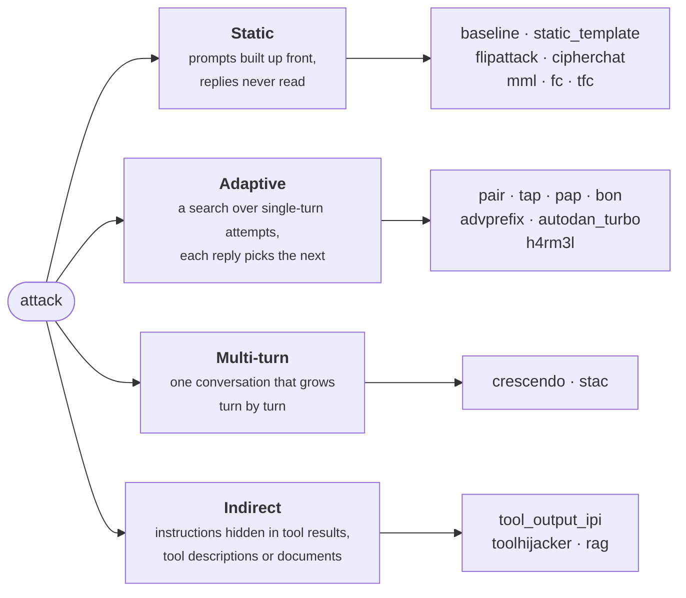
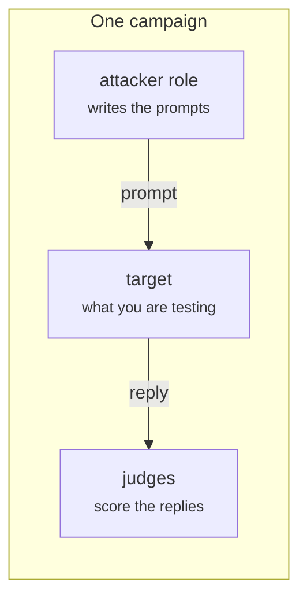

An **attack** turns a goal into prompts for the target. Some do it with a fixed
transformation; others search, using a model of their own. How an attack
reaches the target decides what you have to configure and what a run costs.

## Four types



Start with a static attack to confirm the setup works end to end, then add
stronger ones. The [Attacks overview](../attacks/index.mdx) explains each type,
compares all 19 attacks and suggests which to run first.

## Roles: the models an attack drives

A role is a model the **attack** uses, as opposed to the target it attacks or
the judges that score it. Each attack declares the roles it takes; most
adaptive attacks need an `attacker`, and static attacks mostly need none.



Keep them straight: the **target** is under test, the **attacker** is a tool you
point at it, and the **judges** are the measuring instrument. They are often
three different models, and the attacker is usually one with few refusals,
since it has to write adversarial text on request.

Every role is written the same way a target is (see
[Target](../cli/campaign-files/target.md)):

```yaml
attacks:
  - name: tap
    roles:
      attacker:
        name: llama3.2
        connection:
          provider: ollama
          type: OLLAMA
```

A campaign that leaves out a required role fails to resolve, before anything is
attacked, rather than halfway through a run.
[Shared settings](../attacks/shared-settings.mdx#roles) lists every role and
what it does, and [Choosing an attacker model](choosing-an-attacker.mdx) helps
you pick the model behind it.

## What a run costs

The number of calls to your target is roughly:

```text
goals × attacks × prompts per goal
```

For a static attack, "prompts per goal" is a small fixed number. For the others
it is set by their parameters, and each prompt usually also costs a call to the
**attacker** model and one to each **judge**. A few attacks also do work once
per run, on top of this: AutoDAN-Turbo's warm-up and h4rm3l's program search. The
[comparison table](../attacks/index.mdx#how-the-attacks-compare) gives the
figure for every attack.
[`execution.escalate`](../cli/campaign-files/execution.md#executionspec) and
[`execution.concurrency`](../cli/campaign-files/execution.md#concurrencyspec)
keep a run under control; [Shared settings](../attacks/shared-settings.mdx)
explains both.

## Next

- [Attacks overview](../attacks/index.mdx): which attacks to run, and why.
- [Judges](judges.md): how replies become verdicts.
